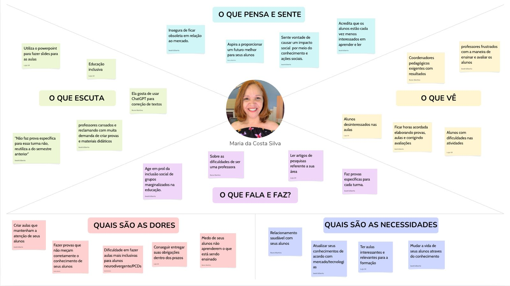

# Entrega 3 — Personas, mapa de empatia, contexto de uso e jornada

**Data:** 03/09/2026
**Status:** 🟩 concluída 
**Responsabilidade:** 1 persona por integrante; 1 mapa de empatia, 1 contexto de uso consolidado e 1 jornada por equipe (salvo orientação diferente do docente).

## Objetivo da atividade

Representar grupos de usuários de forma útil para decisões de design. Persona não é personagem decorativo: suas características devem alterar requisitos, prioridades, linguagem, fluxos ou critérios de avaliação.

## Atenção a projetos técnicos

Em TCCs sem interface original, a persona pode representar um **profissional que se apropria da contribuição técnica**: DBA, analista, cientista de dados, administrador, pesquisador, técnico, operador, gestor ou especialista de domínio.

Não escolha um perfil apenas porque “parece combinar” com a tecnologia. Explique **qual objetivo esse perfil teria e qual parte da contribuição do TCC produziria valor para ele**. Se ainda for hipótese, mantenha como hipótese/proto-persona a validar.

Também considere papéis diferentes quando houver tarefas distintas, por exemplo:

- operador que executa análises;
- administrador que configura e gerencia permissões;
- especialista que interpreta resultados;
- gestor que consulta relatórios e decide;
- auditor que revisa histórico.

## Entradas da Entrega 1

Antes de criar personas, retome os tipos de usuários, características relevantes, objetivos e hipóteses registradas na Entrega 1. A persona **não deve transformar uma hipótese inicial em fato por meio de uma história fictícia**.

| Item da Entrega 1 | Status inicial | Evidência disponível agora | Como será tratado nesta entrega |
|---|---|---|---|
| Docentes/elaboradores de provas como usuários diretos | F | A Entrega 1 identifica docentes/elaboradores de provas como os usuários que interagem diretamente com o produto. | Incorporar |
| Docente do Estado de São Paulo como perfil priorizado | F | O recorte do TCC utiliza dados do ENEM referentes ao Estado de São Paulo, e a Entrega 1 definiu esse perfil como prioritário para a interface. | Incorporar |
| Necessidade de conhecimento tecnológico para utilizar a ferramenta | H04 | A Entrega 1 registra essa característica como hipótese, sem evidência suficiente para afirmar o nível de conhecimento tecnológico do público. | Manter como hipótese e investigar |
| Uso da ferramenta durante a elaboração de avaliações | H04 | A Entrega 1 relaciona o uso à aplicação/elaboração de avaliações, mas não apresenta evidência sobre a frequência ou o momento exato de uso. | Manter como hipótese e investigar |
| Aprimorar as avaliações para que representem melhor o desempenho dos estudantes | H03 | Registrado como objetivo esperado na Entrega 1, mas ainda como hipótese quanto ao benefício efetivamente percebido pelo usuário. | Manter como hipótese e investigar |
| Docente precisa interpretar métricas sobre características estruturais das provas | F | A Entrega 1 identifica as métricas e características estruturais que precisam ser interpretadas para apoiar decisões sobre a avaliação. | Incorporar |
| Docente possui dificuldade para identificar possíveis efeitos das características estruturais da prova | F | Atualmente essa análise depende principalmente do conhecimento, experiência e repertório do próprio docente. | Incorporar |
| Alunos são afetados pelos resultados da ferramenta | H | A Entrega 1 identifica os alunos como stakeholders afetados, mas não como usuários diretos da interface. | Manter como hipótese e não representar como usuário da persona |
| Resultados da análise podem fornecer subsídios para docentes/elaboradores avaliarem características estruturais das provas e ajustarem sua dificuldade | H02 | A Entrega 1 apresenta essa possibilidade como uma contribuição do projeto, mas ainda não há evidência de que os usuários realmente utilizariam essas informações dessa forma. | Manter como hipótese e investigar |

## 1. Personas

### Persona P01 — Maria da Costa Silva

**Autor(a):** Luana Bortko Rodrigues **RA:** 24.123.006-9   
**Tipo:** primário 
**Base de evidências:** Proto-persona a validar 
**Hipóteses da Entrega 1 relacionadas:** H02, H03 e H04  <!-- VALIDAR COM AJSUTES DO NUNO EX H4 DIVIDIDA EM H4 E H5, MAIS HIPOTESES DE PERSONA -->

| Campo | Descrição |
|---|---|
| Faixa etária / contexto relevante | [H] 64 anos, professora da educação básica, atuando no ensino médio de uma escola pública do estado de São Paulo. |
| Ocupação/papel | [H] Professora de Literatura do ensino médio |
| Conhecimento do domínio | Possui conhecimento sobre práticas pedagógicas, avaliação e preparação de estudantes do ensino médio para vestibulares. Tem familiaridade com o contexto do ENEM e com as dificuldades apresentadas pelos alunos na interpretação e resolução de questões. |
| Experiência tecnológica | [H] Possui experiência básica com ferramentas digitais utilizadas no ambiente escolar, como computadores, plataformas educacionais e editores de documentos. Também tem experiência no uso de ferramentas de IA, para auxilio na correção de textos |
| Objetivos | [H] Seu objetivo principal é preparar os estudantes, por meio do ensinamento claro dos conteúdos para os vestibulares, para que eles ingressem na universidade. Deseja tornando as aulas sempre muito didáticas, claras e engajantes para que seus alunos aprendam e não decorem. Além disso quer ter um maior impacto social por meio do conhecimento e ações sociais.|
| Necessidades | [H] Necessita manter seus conhecimentos atualizados, especialmente em relação a novas tecnologias, e contar com recursos que auxiliem tanto no planejamento de aulas interessantes e relevantes quanto na elaboração de provas. Também valoriza um bom relacionamento com os alunos e busca formas de contribuir para seu desenvolvimento acadêmico por meio da educação. |
| Dores/frustrações | [H] Sinte dificuldade em elaborar avaliações que meçam a real compreensão dos alunos sobre o conteúdo, evitando que o resultado dependa apenas da memorização superficial de conceitos tem limitações ao utilizar softwares mais técnicos, com configurações avançadas; criar aulas capazes de manter a atenção dos estudantes e em elaborar avaliações que representem adequadamente seus conhecimentos, tendo medo que seus alunos não consigam absorver corretamente o conteúdo dado em suas aulas. Também enfrenta desafios para tornar suas aulas mais inclusivas, além da pressão para cumprir suas obrigações dentro dos prazos. A rotina de trabalho pode dificultar a conciliação entre vida profissional e familiar. |
| Motivadores | [H] Busca melhorar continuamente sua prática como professora e oferecer aulas mais interessantes e engajantes para seus alunos. Sente-se motivada por soluções que facilitem seu trabalho e permitam realizar suas atividades de forma mais eficiente, além de valorizar a inclusão social e a redução das desigualdades enfrentadas por grupos marginalizados no processo de educação. |
| Restrições/acessibilidade | [H] Possui tempo limitado para análises devido à rotina de trabalho. Tem um conhecimento básico de técnologia e pouco conhecimento de métricas de estátistica |
| Ambiente típico de uso | [H] Escola pública, sala dos professores isolada em sua cabine, ou sala de aula separada dos estudantes, utilizando computador ou notebook e conexão com a internet. |
| Comportamentos relevantes |[H] Costuma buscar informações que possam auxiliar no planejamento das aulas e na preparação dos alunos para avaliações. Prefere resultados objetivos e visualizações que permitam identificar rapidamente padrões e possíveis relações entre as características das questões e o desempenho. |

**Decisões de design influenciadas por P01:**

- A experiência tecnológica básica a intermediária e a falta de conhecimento estatístico avançado de P01 influenciaram a escolha por uma interface simples, objetiva e com resultados apresentados de forma visual. Sua rotina de trabalho e disponibilidade limitada de tempo também levaram à priorização de interações diretas e à redução de etapas desnecessárias.

### Persona P02 — João Paulo de Aquino Gonzaga

**Autor(a):** Beatriz Manaia Lourenço Berto **RA:** 22.125.060-8  
**Tipo:** Secundária  
**Base de evidências:** proto-persona a validar   
**Hipóteses da Entrega 1 relacionadas:** H02, H03 e H04  <!-- VALIDAR COM AJSUTES DO NUNO EX H4 DIVIDIDA EM H4 E H5, MAIS HIPOTESES DE PERSONA -->

| Campo | Descrição |
|---|---|
| Faixa etária / contexto relevante | [H] João é um adolescente de 18 anos, é estudante de ensino médio integrado ao técnico, estuda em escola particular, é muito focado nos estudos para ingressar em uma universidade pública de São Paulo. |
| Ocupação/papel | É um aluno do secundo ano do ensino médio integrado ao técnico de informática. |
| Conhecimento do domínio | [H] Desde a infância, demonstra forte interesse por 
computadores e tecnologia. No ensino técnico, vem aprofundando esse conhecimento de 
forma integrada com disciplinas escolares e idiomas, ao passo que cursa ensino técnico em informática.|
| Experiência tecnológica | [H] **Média.** Possui contato com tecnologia desde a infância por meio de jogos digitais, construção de PC e estudos a parte devido a curiosidade, tem facilidade com as tecnologias por crescer no mundo digital e utilizar frequentemente dispositivos tecnologicos no seu dia a dia.|
| Objetivos | [H] Deseja ingressar em uma universidade pública, seja por meio de vestibular próprio ou pela nota do ENEM (SISU) e cursar Engenharia da computação. |
| Necessidades | [H] Necessita preparar-se muito bem para os vestibulares como ENEM e FUVEST, para conseguir ingressar na universidade, precisa de fácil acesso a cursos preparatórios para reforçar ainda mais os aprendizados e treinamentos de sua escola. |
| Dores/frustrações | [H] Possui uma forte cobrança em relação aos estudos e o que esperar do futuro, tem receio de que saber apenas os conteudos teóricos das disciplinas não seja suficiente para ingressar na universidade pois enfrenta problemas ao realizar provas como ansiedade, estresse, difucldade de interpretação de textos muito longos e falta de atenção. |
| Motivadores | [H] Sua principal motivação é conseguir um diploma universitário e seguir carreira na área de tecnologia que o interessa desde jovem. |
| Restrições/acessibilidade | Tem transtornos de saúde mental como ansiedade e TDA, oque afeta sua capacidade de realizar plenamente a prova.|
| Ambiente típico de uso | [H] Utiliza o resultado da interação do docente com o sistema durante a realização das avaliações em dois cenários: em sala de aula com outros alunos e online sozinho. Para a modalidade online, exige-se ambiente silencioso e conexão à internet, além de materiais de apoio (como papel, lápis e borracha) quando solicitados pelas questões.|
| Comportamentos relevantes |[H] Aplica rotinas rígidas de estudo e metodologias de planejamento (como cronogramas) para mitigar a ansiedade pré-prova. Durante a realização das avaliações, necessita de um ambiente estritamente silencioso e com controle de distrações para manter o foco. Em testes digitais, busca gerenciar seu tempo de forma ativa e é altamente sensível a interrupções visuais ou sonoras no sistema, que podem comprometer sua atenção. | 

**Decisões de design influenciadas por P02:**

No contexto da disciplina IHC faz sentido a persona 02 impactar as decisões de design do sistema de análise da prova,Nesse sentido, o impacto de design seria refletido por meio de o sistema fornecer perguntas específicas sobre idade/série escolar/ grau de ensino para ajudar nas análises do impacto estrutural da prova no desempenho dos alunos. afinal o aluno pode ter diferentes faixas etárias, níveis de escolaridade, familiaridade com algumas características estruturais. 
Porém, no contexto do nosso TCC o aluno não impacta em nada o design do sistema ao passo que a aplicação analisa apenas como as características estruturais que já analisamos do ENEM impactam em outras provas, não considerando para essas análises fatores como idade dos alunos.

<!-- ex not fiscal eh pro fisco (primaria), e secundaria eh qqr um q consome nota q tbm tem q entender p fiscaliza se entendeu correta ent o i pacto da secundaria (q eh qqr pessoa) eh tornar a nota mais amigavel e entendivel p todo mundo, pq se fosse so p primario podia ser mais tecnica por ex -->
-

### Persona P03 — Vera Coelho 

**Autor(a):** Nuno Martins Guilhermino da Silva **RA:** 22.126.099-5   
**Tipo:** Primária  
**Base de evidências:** Proto-persona a validar   
**Hipóteses da Entrega 1 relacionadas:** H02, H03 e H04  <!-- VALIDAR COM AJSUTES DO NUNO EX H4 DIVIDIDA EM H4 E H5, MAIS HIPOTESES DE PERSONA -->

| Campo | Descrição |
|---|---|
| Faixa etária / contexto relevante | [H] 32 anos. Professora de inglês em uma escola online de línguas|
| Ocupação/papel | [H] É professora de inglês à distância, trabalhando em uma escolinha de línguas. |
| Conhecimento do domínio | [H] Possui conhecimento avançado sobre ensino de língua inglesa e experiência prática na elaboração e aplicação de avaliações, mas não necessariamente possui conhecimento especializado em análise estatística de itens. |
| Experiência tecnológica | [H] Utiliza computadores e plataformas digitais regularmente para ministrar aulas, preparar materiais e acompanhar alunos. Possui familiaridade com ferramentas como Microsoft Office e plataformas de ensino a distância, mas pode não estar familiarizada com ferramentas especializadas de análise de avaliações. |
| Objetivos | [H] Seu maior objetivo como profissional é que seus alunos saiam de suas aulas se sentindo mais confiantes em suas habilidades e preparados para lidarem com usos da língua inglesa em situações reais de forma autônoma.|
| Necessidades | [H] Com o seu trabalho, ela precisa acompanhar o progresso de seus alunos ao longo do andamento de sua tutela, e para isso ela precisa ter certeza que suas provas são apropriadas para o nível de cada turma/pessoa, e com sua rotina corrida, precisa de rápida certificação de que suas avaliações são formuladas com qualidade. |
| Dores/frustrações | [H] Ela se sente frustrada quando a energia na qual lhe é dada em sala de aula não se traduz em um ambiente de avaliação. Tem dificuldade para determinar se o baixo desempenho dos alunos representa uma dificuldade real no conteúdo ou se é um resultado de um trabalho mal-feito, a deixando insegura sobre a sua qualidade como educadora e a segurança do seu emprego. |
| Motivadores | [H] Seu maior motivador é poder ver em tempo real os resultados dos seus esforços transparecendo em seus alunos, além de ver-los engajando com suas aulas. Outro lado deste engajamento que a motiva é a qualidade resultar em manter o seu emprego. |
| Restrições/acessibilidade | [H] Não apresenta necessidades específicas de acessibilidade identificadas. Possui boa conexão com a internet e letramento digital suficiente para utilizar plataformas educacionais.| 
| Ambiente típico de uso | [H] Ela faz todas as suas atividades de docência, incluindo planejamento e formulação de atividades do seu escritório em sua casa, sozinha, utilizando o seu computador pessoal e conexão a internet. |
| Comportamentos relevantes | [H] Costuma elaborar e revisar avaliações entre outras atividades profissionais, buscando reutilizar ou adaptar questões de avaliações anteriores. Consulta materiais e ferramentas digitais para preparar suas aulas e avaliações. Após uma prova, acompanha o desempenho individual dos alunos para identificar conteúdos que precisam ser reforçados.  |

**Decisões de design influenciadas por P03:**

Como ela possui conhecimento limitado sobre métricas de avaliação, as métricas devem ser apresentadas de forma clara, contextualizada e acompanhadas de explicações que facilitem sua interpretação. Isso reduz a necessidade de conhecimento estatístico prévio e permite que a professora utilize os resultados para avaliar a qualidade das questões e o desempenho dos alunos.

### Síntese das personas

Explique diferenças entre os perfis e qual persona é prioritária. Evite personas duplicadas que só mudam nome/foto.

A criação das três personas baseia-se em diferenças reais de rotina, letramento digital e uso de métricas, alterando os requisitos da interface.

A persona P01 (Maria) é a Persona Primária Prioritária por ser a usuária direta que mais se beneficiaria com o sistema devido a preparação de estudantes para o ENEM. Ela enfrenta as maiores restrições: tem experiência tecnológica básica, pouca familiaridade com estatística, rotina corrida na rede pública de SP e trabalha em ambientes com interrupções. Como atua diretamente na preparação para o ENEM (foco do TCC), projetar o MVP para as suas limitações garante uma interface simples e acessível para qualquer docente (Design for the Extremes).

A persona P03 (Vera) é a Persona Primária Secundária porque também é usuária direta do sistema (docente elaboradora de provas), mas possui maior experiência tecnológica e trabalha em home office silencioso. Ela é primária por interagir com a interface, mas secundária na prioridade por ter menos restrições técnicas e de ambiente do que P01. Sua presença valida se o sistema funciona bem para diferentes perfis de professores.

A persona P02 (João Paulo) é a Persona Secundária pois não interage com a interface do sistema (não faz upload nem analisa gráficos). Ele representa o estudante impactado indiretamente pelas decisões do professor, justificando requisitos de design que reduzem ruídos na prova (como alertas de enunciados longos para alunos com ansiedade ou TDAH) para gerar avaliações mais justas.

## 2. Mapa de empatia — equipe

**Persona escolhida:** P01 

**Justificativa:** A persona da professora que da aula em uma escola foi escolhida como principal por estar mais alinhada ao público-alvo do TCC. Como o projeto investiga a relação entre o formato das questões do ENEM e o desempenho dos estudantes, esse perfil possui contato mais direto com alunos que se preparam para esse exame e pode utilizar os resultados da ferramenta como apoio em sua prática pedagógica. As demais personas também são relevantes, mas possuem uma relação menos direta com o contexto central do projeto.

Documente também em texto: o que vê; ouve; diz/faz; pensa/sente; dores; ganhos. Diferencie **evidência** de **hipótese**.
 
**O que vê**
[H] Maria observa um ambiente educacional marcado por diferentes desafios. Percebe coordenadores pedagógicos cada vez mais exigentes em relação aos resultados de seu trabalho. Também observa colegas frustrados com as formas tradicionais de ensinar e avaliar os alunos. Em seu cotidiano, presencia alunos desinteressados pelas aulas, com dificuldades para realizar atividades. Além disso, devido a muito trabalho, fica horas acordada elaborando provas, aulas e corrigindo avaliações.

**O que pensa e sente**
[H]Maria sente isnegurança de ficar obsoleta em relação ao mercado, deseja proporcionar um futuro melhor para seus alunos por meio da educação, lém de uma vontade de causaar impacto social por meio do conhecimento e ações sociais. Também pemnsa que os alunos estão cada vez menos interessados em aprender e ler.

**O que escuta**
[H]Maria mantém contato frequente com conteúdos relacionados à educação. Acompanha conteúdos sobre educação inclusiva. No cotidiano, também utiliza ferramentas digitais, como PowerPoint para preparar aulas e ChatGPT para auxiliar na correção de textos, buscando informações sobre atualidades e temas relacionados à sua área de atuação. Ademais, escuta frequentemente seus colegas cansados, reclamando com muita demanda de criar provas e materiais didáticos e a avisando para não fazer prova específica para cada turma, reutiliza a do semestre anterior.

**O que fala e faz**
[H]Maria age em prol da inclusão social de grups marginalizados na educação, fala sobre as dificuldades de ser uma professora e le artigos de pesquisas referentes a sua área.

**Quais são as dores**
[H]Entre suas principais dificuldades estão a criação de aulas capazes de manter a atenção dos alunos e a elaboração de avaliações que representem adequadamente seus conhecimentos. Também enfrenta desafios para tornar suas aulas mais inclusivas. A necessidade de cumprir com os prazos de suas obrigações como professora. Além disso, preocupa-se com a possibilidade de seus alunos não aprenderem adequadamente o conteúdo trabalhado.

**Quais são as necessidades?**
[H]Maria busca melhorar continuamente sua prática profissional, oferecendo aulas mais interessantes e relevantes para a formação de seus alunos. Valoriza a possibilidade de manter seus conhecimentos atualizados em relação ao mercado e tecnologias. Além disso, busca ter um relacionamento saudável com seus alunos.

## 3. Contexto de uso — consolidação

| Dimensão | Descrição | Implicação de design |
|---|---|---|
| Usuários | O sistema será utilizado principalmente por docentes e elaboradores de provas interessados em analisar características estruturais de avaliações antes de sua aplicação. Os perfis podem apresentar diferentes níveis de conhecimento tecnológico e estatístico. | A interface deve ser acessível a usuários com diferentes níveis de conhecimento, utilizando linguagem clara e apresentando as métricas de forma objetiva e interpretável. |
| Tarefas | O usuário realiza o upload da prova em PDF, insere os dados necessários para a análise, visualiza as métricas obtidas e consulta o detalhamento dos cálculos e resultados para identificar possíveis características da prova que possivelmente mais influenciamque o desempenho. | As tarefas devem seguir um fluxo simples e direto, com poucas etapas e orientações claras. As métricas devem ser apresentadas de forma visual, acompanhadas de explicações e detalhamentos quando necessário.|
| Equipamentos | O acesso ocorre principalmente por computador ou notebook, especialmente por meio do dispositivo utilizado pelo docente em suas atividades profissionais. | Priorizar uma interface web adequada para telas de computador e notebook, garantindo boa organização das informações e legibilidade dos gráficos, indicadores e tabelas. |
| Ambiente físico | [H] O uso ocorre principalmente em dois locais: (1) na escola instituição de ensino(escola e faculdade), seja em mesas compartilhadas na sala dos professores, na sala do professor,  em computadores do laboratório ou no próprio notebook do docente, para acessar o sistema basta ter conexão com a internet e o pdf da avaliação; e (2) em casa/outro lugar com infraestrutura para apoiar o notebook e internet. | O sistema deve permitir uma utilização autônoma e eficiente, sem depender de condições específicas do ambiente, deve ser projetado layouts com paleta de cores de contraste, ter gráficos simplificados (barras simples e marcadores numéricos diretos em vez de dispersões complexas). Implementar salvamento automático em local storage para não perder o upload ou os filtros aplicados caso a aba seja fechada ou a professora precise interromper a análise. As principais informações devem ser facilmente identificadas para reduzir o tempo necessário para realizar as tarefas. |
| Ambiente social/organizacional | [H] O uso ocorre no contexto de trabalho docente, durante o planejamento e elaboração das avaliações. O professor lida com prazos curtos para entregar as provas prontas e sofre cobranças da coordenação para manter o nível de aprovação dos alunos no ENEM. A elaboração das avaliações sofre influência de regras e restrições institucionais de ensino, como o limite máximo de páginas por prova, além disso, existe a insegurança se a prova criada realmente mede o aprendizado e um receio de usar ferramentas com termos estatísticos complexos que dificultem o uso no dia a dia. Os resultados podem servir como apoio à tomada de decisões sobre a estrutura das provas. | A interface deve apresentar os resultados de maneira organizada, facilitando sua consulta e interpretação pelo docente e deve atuar como uma "segunda opinião pedagógica", substituindo termos estatísticos difíceis por avisos e explicações diretas|
| Papéis/permissões/governança | O docente atua como usuário responsável pelo envio das provas e pela consulta e interpretação dos resultados gerados pelo sistema. Não há necessidade de diferentes níveis de permissão para a realização da análise. | Manter o fluxo de acesso e utilização simples, evitando a inclusão de mecanismos administrativos ou níveis de permissão que não sejam necessários ao escopo atual. |
| Volume de dados/histórico | A análise é realizada a partir de provas em PDF e dos dados necessários para sua análise. O sistema pode lidar com diversas questões e métricas referentes a uma mesma avaliação, com base nos estudos do TCC sobre o ENEM, mas o histórico de múltiplas avaliações não é o foco | Organizar os resultados da análise e utilizar recursos como tabelas, gráficos, indicadores e tooltips/popup para o detalhamento, evitando sobrecarregar a interface |

## 4. Jornada do usuário — equipe

**Persona:** P01
**Objetivo da jornada:** Avaliar o possível impacto do formato da prova no desempenho dos alunos, identificando oportunidades de melhoria em sua estrutura antes de sua aplicação.
**Início e fim da jornada:** 
*Início da jornada:* Maria acabou de elaborar uma prova de múltipla escolha para sua turma. Antes de aplicá-la, ela revisa as questões e percebe que não tem certeza se aspectos estruturais da avaliação (como extensão dos enunciados, presença de imagens, ordem das questões e linguagem utilizada) podem influenciar o desempenho dos alunos. Como busca elaborar avaliações mais justas e já tem interesse em utilizar tecnologias para aprimorar sua prática, ela decide utilizar a plataforma como uma segunda opinião baseada em dados do ENEM.

*Fim da jornada:* Após analisar os resultados fornecidos pela plataforma, Maria identifica possíveis características da prova que podem estar associadas ao desempenho dos alunos. Ela utiliza essas informações, em conjunto com sua experiência pedagógica, para decidir se deve reformular determinadas questões antes da aplicação. A experiência pode levá-la a retornar à plataforma futuramente para analisar novas provas ou versões revisadas, buscando aprimorar continuamente suas avaliações.
  

| Etapa | Situação/ação | Objetivo | Pensamento/emoção | Dor | Oportunidade de design | Evidência |
|---|---|---|---|---|---|---|
| 1 O que motiva a usar a interface | Maria finaliza uma prova de múltipla escolha e decide analisá-la antes de aplicá-la aos alunos| Verificar se características estruturais da prova podem interferir no desempenho e obter uma segunda opinião sobre sua avaliação, para auxiliar na avaliação justa dos usuários. | “Será que meus alunos terão dificuldade por causa da forma como a prova foi elaborada, e não pelo conteúdo?” Sente insegurança e busca maior confiança. | Não possui uma forma rápida e baseada em dados para identificar possíveis problemas estruturais na prova. A revisão manual depende principalmente de sua própria experiência. | Deixar clara a proposta da ferramenta, seus benefícios e limitações; comunicar que a análise é indicativa e baseada em correlações do ENEM, funcionando como complemento à avaliação pedagógica. | Persona: professora que busca aprimorar suas práticas e utilizar tecnologias para melhorar suas avaliações. |
| 2.1 Acesso e envio do arquivo  | Maria acessa a plataforma, faz o upload do PDF da avaliação recém-criada e preenche os parâmetros básicos solicitados para contextualizar a análise. | Realizar o envio da prova de forma rápida e sem complicações técnicas para dar início à verificação. | “Espero que o arquivo seja aceito sem erros e que o preenchimento seja simples.” (Expectativa e leve apreensão sobre a facilidade do sistema). | Receio de falhas ou lentidão no upload do arquivo PDF e dúvida se os parâmetros exigidos serão complexos. | Oferecer interface intuitiva para upload (drag-and-drop), barras de progresso visuais durante o processamento e campos de contexto curtos e objetivos. | Requisitos do MVP; Persona P01 (experiência tecnológica básica/intermediária e tempo reduzido na rotina).|
| 2.2 Leitura do painel e das métricas estruturais  | Com a análise concluída, Maria navega pelo painel principal, onde visualiza indicadores e gráficos coloridos sobre a estrutura física da prova (como contagem de palavras, presença de imagens e nível de formalidade). | Compreender a visão geral das características físicas da avaliação comparadas aos padrões de referência. | “Olha só, minha prova tem enunciados bem mais longos do que a média... Mas o que exatamente esse gráfico significa na prática?” (Curiosidade, interesse e busca por contextualização). | Dificuldade para interpretar gráficos e indicadores quantitativos se forem apresentados sem explicações diretas e acessíveis. | Exibir métricas por meio de gráficos simplificados (barras e marcadores diretos), acompanhados de tooltips explicativos que dispensem termos estatísticos avançados.| Persona P01 (falta de conhecimento estatístico avançado e preferência por resultados objetivos); Requisitos da interface.|
| 2.3 Consulta aos diagnósticos e possíveis impactos  | Maria explora o detalhamento dos gráficos fornecidos pela plataforma, identificando, por exemplo, como o formato das questões pode influenciar o desempenho final dos estudantes. | Identificar pontos de atenção na prova onde o formato físico (e não a falta de estudo) pode atrapalhar o aluno na resolução. | “Agora entendi! Essa questão pode cansar os alunos pela extensão do texto, e não porque o conceito seja difícil. Vou revisar essa questão antes de imprimir.” (Clareza, alívio e senso de ganho pedagógico). | Receio de não entender a relação entre a métrica e o desempenho real, ou sentir que o sistema está impondo alterações em vez de sugerir. | Apresentar diagnósticos em linguagem natural e tom consultivo (ex: “Esta questão possui texto 40% mais longo que a média do ENEM”), deixando claro que a decisão de alteração é sempre do docente. | Persona P01 (objetivo de elaborar avaliações mais justas) e Hipóteses H02 e H03 da Entrega 1. |

| 3 O que acontece depois que sai da interface | Maria utiliza os resultados da análise para revisar e, se necessário, ajustar a prova antes de aplicá-la em sua versão revisada aos alunos. [H] Como hipótese a investigar, espera-se que a redução de ruídos estruturais na avaliação forneça dados mais limpos para apoiar a reflexão pedagógica do docente sobre o desempenho dos estudantes. | Garantir que a avaliação meça o conhecimento dos alunos com o menor impacto possível de barreiras estruturais do formato da prova, o que permite identificar de maneira mais objetiva suas dificuldades e compreender quais conteúdos precisam ser reforçados em aula. | “Tenho maior confiança de que a estrutura da prova não atrapalhou meus alunos na resolução das questões e que a avaliação medirá o que meus alunos realmente aprenderam.” (Segurança e alívio pedagógico). | Dificuldade em isolar se o baixo desempenho do aluno ocorreu por desconhecimento do conteúdo ou por fadiga/dificuldade de leitura/interpretação provocada pela estrutura do exame o que pode resultar em uma percepção equivocada sobre o que eles realmente aprenderam. | Oferecer a funcionalidade de exportar um resumo das alterações recomendadas para que o docente acompanhe se as melhorias estruturais facilitaram a aplicação. | Hipótese H02 e H03 da Entrega 1 (a relação entre ajustes na estrutura da prova e o benefício real percebido no planejamento pedagógico permanece como hipótese a validar). |
 
> A jornada pode incluir etapas **antes, durante e depois** do uso do produto. Não transforme a jornada em lista de telas.

## Síntese

Quais necessidades e objetivos devem obrigatoriamente aparecer nos cenários e nas tarefas seguintes?

Os cenários e as tarefas devem contemplar o objetivo dos professores de realizar avaliações mais justas e que representem adequadamente o conhecimento dos estudantes. Para isso, a ferramenta deve permitir que o professor analise as características do formato de suas provas e identifique possíveis aspectos que possam estar influenciando a avaliação do desempenho dos alunos. A análise das métricas, portanto, deve funcionar como um meio para que o professor reflita sobre a construção de suas avaliações e possa tomar decisões mais conscientes sobre sua elaboração.
A interface deve ser simples, objetiva e acessível a usuários com diferentes níveis de experiência tecnológica e conhecimento estatístico. As métricas disponibilizadas devem possuir descrições e explicações claras, permitindo que os professores compreendam o que cada medida representa e interpretem os resultados sem a necessidade de conhecimentos técnicos avançados.

## Histórico de revisões

- 1. Personas: Aprimorei as diferenças entre as personas 1 e 3 (primárias) além de alterar a persona 2 para "aluno", como persona secundária, também adicionei [H] para simbolizar as hipóteses e melhorei suas respectvas descrições.

- 2. Mapa da empatia: Removi os elementos biográficos periféricos e elaborei mais a escrita de alguns elementos existentes e atualizei o texto.

- 3. Contexto de uso: Tornei mais específico as descrições de "ambiente físico"e "ambiente social/organizacional.

- 4. Jornada do usuário: Expandi o "durante" em etapas mais detalhadas.

- 5. Síntese das personas: trouxe a explicação e diferença entre os perfies.

- 6. Revisei checklist.

-  Na rastreabilidade atualizei as personas na tabela 3, na tabela 2 atualizei as evidências e como/onde investigar, na tabela 1 atualizei o recorte de IHC e na tabela 4, adicionei as personas em artefatos relacionados. 

## Checklist

- [X] Existe pelo menos uma persona por integrante.
- [X] As personas não são apenas diferenças demográficas superficiais.
- [x] Está claro o que é dado real e o que é hipótese/proto-persona.
- [x] A persona não “validou por ficção” uma hipótese da Entrega 1; afirmações continuam marcadas como hipótese quando não há evidência.
- [ ] Objetivos e dores têm consequência para o design.
- [x] Contexto de uso está coerente com a Entrega 1.
- [ ] Em TCC sem interface original, a persona possui relação explícita com a contribuição técnica.
- [x] Papéis administrativos, técnicos e decisórios só foram criados quando possuem objetivos/tarefas diferentes.
- [x] Jornada possui etapas, dores e oportunidades e não é apenas wireflow.
- [x] IDs das personas foram adicionados à rastreabilidade.
