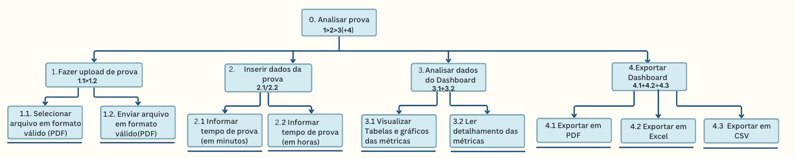
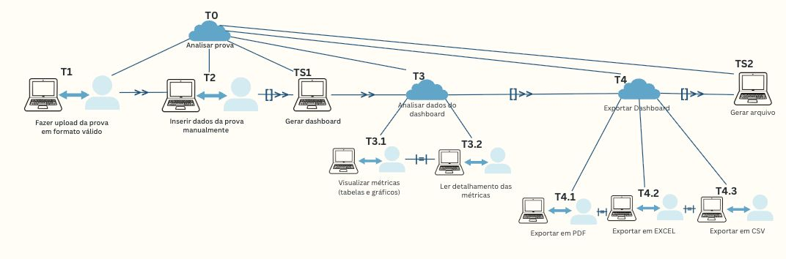
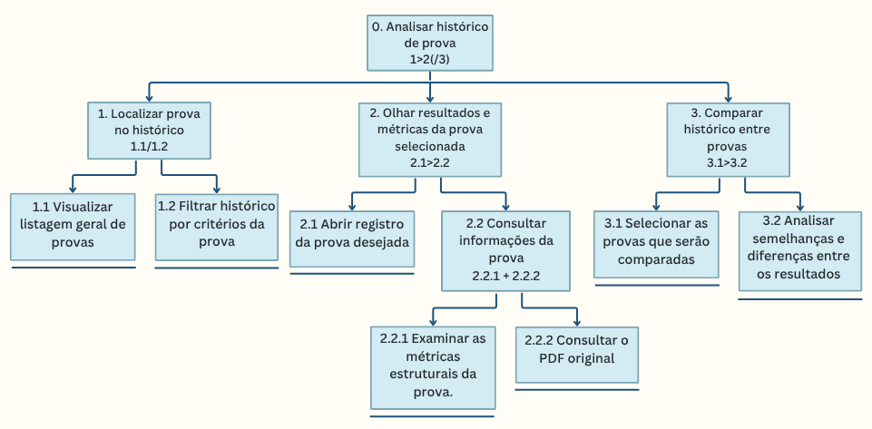
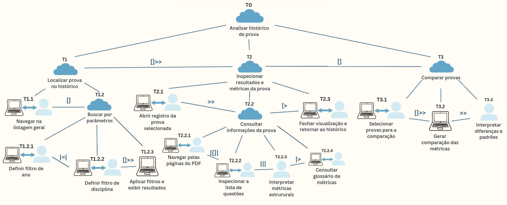
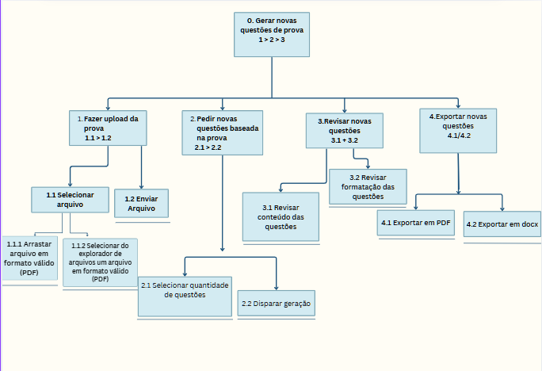
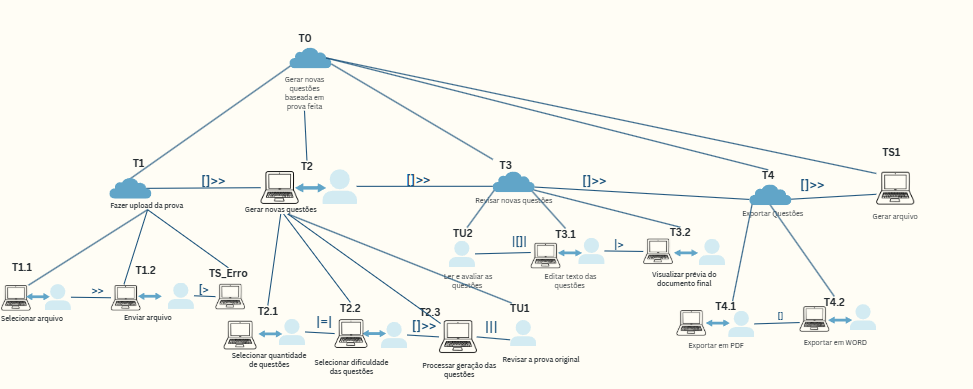

# Entrega 5 — Análise de tarefas: HTA, GOMS e CTT

**Data:** 13/09/2026  
**Status:** 🟨 Em andamento  
**Responsabilidade:** cada integrante modela pelo menos 1 HTA, 1 GOMS e 1 CTT. As três técnicas podem abordar a mesma funcionalidade ou funcionalidades distintas, conforme a orientação da disciplina.

## Objetivo da atividade

Modelar tarefas importantes sob perspectivas complementares: decomposição hierárquica (HTA), estrutura de metas/métodos/operações (GOMS) e relações temporais entre tarefas (CTT). O diagrama deve ser acompanhado de interpretação textual.

## Para projetos cujo TCC não previa interface

Modele **tarefas humanas relacionadas ao uso da contribuição técnica**, e não a implementação interna do algoritmo. Exemplos de boas tarefas para análise:

- investigar uma consulta de baixo desempenho;
- configurar uma análise e selecionar parâmetros;
- submeter um dataset e verificar sua validade;
- acompanhar uma execução demorada;
- comparar dois resultados/modelos;
- interpretar uma recomendação e decidir se a aceita;
- localizar uma execução anterior usando busca/filtros;
- gerar e compartilhar um relatório;
- administrar papéis/permissões quando isso for parte do trabalho real;
- revisar um alerta e registrar uma decisão.

Um CRUD pode gerar tarefas relevantes, mas “cadastrar usuário” só merece modelagem se tiver significado no domínio (papéis, validações, riscos, permissões, dependências).

## Seleção das tarefas

| ID | Tarefa | Persona/cenário de origem | Frequência/criticidade | Autor responsável |
|---|---|---|---|---|
| T01 | Analisar a prova | P1/P3 e C02 | Alta - várias vezes por semestre, sempre que tiver alguma prova a ser aplicada | Beatriz |
| T02 | Analisar histórico de provas | P1/P3 e C01 | Média - No começo ou finais de semestre | Luana |
| T03 | Gerar novas questões baseadas em provas já elaboradas | P1/P3 e C03 | Média - Múltiplas vezes por semestre, quando tiver interesse em gerar novas avaliações | Nuno |

<!--TAREFAS COMPLEXAS A PONTO DE SEREM MODELADAS

quando for definir obj da entrega 5;
-tem q combinar com grupo os objetivos q maparemos a tarefa:tem q ter a tarefa
ex:

1-obj analisa a prova(o padrao) cenario problema bia

2-obj analsia historico de provas (ja analisadas, dashboard de td prova ja analisda, tem comeco meio e fim, é objetivo cenario problema lu

3-tem conj de prova, uso p faze analise estatisitica e historica de periodo, dado perido faze analise estatisitcia e peço p ia produzir mais x questoes objetivo cenario problema nuno

outra opcao:
-comparar analises de provas (analisa dashboard de td rova q ele analisou,
-relatorios personalizados (?) 
-avaliar escrita???

-usa tabela do 1, parte de filtro e tal  p ajuda se quiser

tarefa n eh upload analise e analisa resultado eh PASSO de 1 tarefa, ta errado, como sei se eh passo ou tarefa?

obj tarefa msm pega do d cenario problema
identifica obj é consdierar ex usuario acoreda, obj faze upload ve se faz sentdio a pessoa acorda vou usa e faze yploiad

ver se obj final de us sistema eh faze upload, as tarefas sao os objetivos 
tcc todo, o sistema q previmos eh o obj de 1 pessoa so

NA MODELAGEM DE HTA GOMS E CTT TEM Q USA TODOS OS RECURSOS DA TECNICA

<!-- TAREFAS:ANALISAR PROVA

esses passos sao de 1 objetivo: analisar prova

1-upload de arquivo contendo prova
  -maneiras de fazer upload?
  -formatos aceitos?
  -padrões que prova precisa ter para ser analisada?
  -...

2-inserção de dados da prova de maneira manual
  -tem difernetes maneiras de ser inserida?
  -...

3-análise do dashboard com métricas da prova
  -maneiras de analisar dashboard?

4-download do dashboard
  -em que formatos?
  -quantas maneiras de fazer download?
-->

> Priorize tarefas necessárias para que o usuário alcance objetivos centrais. Não desperdice a modelagem em ações triviais isoladas, como “clicar em login”, se o objetivo relevante é maior. Da mesma forma, não modele o funcionamento interno do algoritmo como se fosse uma tarefa humana.

---

<!--
tarefas tem q ter complexidade:

DECIDIR 3 OBJETIVOS MAIS IMPORTANTES DO PROJETO
-isso tem haver com duvida q tirmos ontem cm plinio?
-ja q tem 4 tarefas a gnt escolhe 1 objetivo p duplica ent?

ex goms 2 metodos
tem q expandir msm q n seja oq faremoas d vdd , usa emtodo em sua completudw

goms
go
g1 
op
op
op

g2
metodo 1 
regra selecao 
 op 
 op

  g3
  metodo sleecao 2
  op
  op

metodo de selecao sao 2 maneiras de faze msm coisa 
 se no projeto n precisa
 pode traze cois nova q nnc apareceu no texto p treina o metodo
-->

## HTA — T01 Analisar a prova

**Autor(a):** Beatriz Manaia Lourenço Berto — 22.125.060-8

### Descrição da tarefa

<!--{{objetivo, ponto de início, conclusão esperada, contexto}}-->

- Objetivo: Permitir que o docente envie uma prova em um dos formatos aceitos pelo sistema para que suas características estruturais sejam extraídas e analisadas, possibilitando a visualização de métricas que apoiem a tomada de decisão sobre possíveis ajustes na avaliação.

- Ponto de início: O docente possui uma prova pronta para análise, salva no dispositivo que será utilizado para acessar o sistema, em um dos formatos suportados.

- Conclusão esperada: A prova foi carregada com sucesso no sistema e as métricas referentes às suas características estruturais estão disponíveis para consulta e análise.

- Contexto: Cerca de duas semanas antes da aplicação das avaliações, durante o período de preparação e revisão das provas, em ambiente adequado de trabalho, como a instituição de ensino, escritório ou casa, com acesso a computador, recursos digitais e à internet.

### Diagrama

### Decomposição e planos

| ID | Objetivo/operação | Plano/ordem | Problema ou decisão de design observada |
|---|---|---|---|
| 0 | (objetivo) Analisar prova | 1 > 2 > 3 > 4  | {{...}} |
| 1 | (sub objetivo) Fazer upload de prova | 1.1 > 1.2  | {{...}} |
| 1.1 | (operação) Selecionar arquivo em formato válido (PDF) | 1.1 pode ser feita antes ou depois da 1.2 | {{...}} |
| 1.2 | (operação) Enviar arquivo em formato válido(PDF) | 1.2 pode ser feita antes ou depois da 1.1 | {{...}} |
| 2 | (sub objetivo) Inserir de dados da prova | 2.1 / 2.2  | {{...}} |
| 2.1 | (operação) | (decisão) Docente deve escolher entre 2.1 e 2.2 | {{...}} |
| 2.2 | (operação) | (decisão) Docente deve escolher entre 2.1 e 2.2  | {{...}} |
| 3 | (sub objetivo) Analisar dados do Dashboard | 3.1 + 3.2 | {{...}} |
| 3.1 | (operação) Visualizar  Tabelas e gráficos das métricas  |  | {{...}} |
| 3.2 | (operação) Ler  detalhamento das métrica |  | {{...}} |
| 4 | (sub objetivo) Exportar Dashboard | 4.1 + 4.2 + 4.3  | {{...}} |
| 4.1 | (operação) Exportar em PDF| Pode fazer 4.1 ou 4.2 ou 4.3 em paralelo | {{...}} |
| 4.2 | (operação) Exportar em Excel | Pode fazer 4.1 ou 4.2 ou 4.3 em paralelo | {{...}} |
| 4.3 | (operação) Exportar em CSV| Pode fazer 4.1 ou 4.2 ou 4.3 em paralelo | {{...}} |

<!--ACHAM Q COLOCA 2.1 TB? ELE FLO P COLOCA OPERACAO MAS AI N SEI OQ COLOCA EM ORDEM 
!-->
| 0 | (objetivo) Analisar prova | 1 > 2 > 3(+4) | A análise é realizada por meio do dashboard. Como nem todos os docentes podem estar familiarizados com as métricas apresentadas, cada tabela e indicador possui um ícone de informação que exibe uma descrição explicando o que está sendo analisado naquele campo, auxiliando na interpretação dos resultados. |
| 1 | (sub objetivo) Fazer upload de prova | 1.1 > 1.2 | o sistema precisa garantir que o arquivo seja válido antes de processá-lo. |
| 1.1 | (operação) Selecionar arquivo em formato válido (PDF) | 1.1 tem que ser feita antes da 1.2 | O sistema deve apresentar os formatos de arquivo válidos e notificar o usuário sempre que o arquivo selecionado não puder ser analisado, informando a causa do problema e os formatos aceitos pela plataforma. |
| 1.2 | (operação) Enviar arquivo em formato válido(PDF) | 1.2 tem que ser feita depois da 1.1 | O envio pode ser feito por arrastar e soltar ou seleção manual no computador e envio pelo botão. |
| 2 | (sub objetivo) Inserir de dados da prova | 2.1 / 2.2  | Fazer que os respectivos campos de input contenham placeholder descritivos da informação necessária. |
| 2.1 | (operação) Informar tempo de prova (em minutos) | (decisão) Docente deve escolher entre 2.1 e 2.2 | O campo de entrada deve ter um dropdown com minutos e horas e o placeholder deve deixar claro que a unidade é "minutos". O sistema deve converter automaticamente o valor para o formato que o código usa, tornando a inserção mais fácil para o docente. |
| 2.2 | (operação)  Informar tempo de prova (em horas)| (decisão) Docente deve escolher entre 2.1 e 2.2  | A interface deve permitir facilmente alterar entre as unidades (minutos/horas) para a inserção manual por meio de um dropdown ou toggle switch, garantindo que o dado inserido não se perca na troca. |
| 3 | (sub objetivo) Analisar dados do Dashboard | 3.1 + 3.2 | O dashboard deve apresentar as informações de forma clara e intuitiva, utilizando cores adequadas, diferentes tipos de gráficos, tabelas e indicadores para facilitar a compreensão dos resultados. O layout deve priorizar apenas os dados relevantes, evitando poluição visual e auxiliando os docentes na interpretação das métricas apresentadas. 
| 3.1 | (operação) Visualizar  Tabelas e gráficos das métricas  | O 3.1 deve ser feito em paralelo ao 3.2, ambos precisam ser atingidos ao mesmo tempo | Utilizar tipos de gráficos adequados para cada métrica(gráficos de piza, colunas, barras), garantir constraste de cores acessível (WCAG) para que todos os docentes consigam visualizar os dados. |
| 3.2 | (operação) Ler  detalhamento das métrica | O 3.1 deve ser feito em paralelo ao 3.2, ambos precisam ser atingidos ao mesmo tempo | Os textos de detalhamento podem conter fórmulas usadas pelo código para facilitar a compreensão, bem como utilizar linguagem do domínio do professor. Ele deve complementar a informação visual do gráfico, não ser redundante. |
| 4 | (sub objetivo) Exportar Dashboard | 4.1 + 4.2 + 4.3  | a exportação é uma ação secundária. O sistema deve oferecer as opções de forma clara, por mei ode um menu suspenso, por exemplo, sem poluir a tela principal de análise. O arquivo exportado deve manter a consistência visual do dashboard. |
| 4.1 | (operação) Exportar em PDF| Pode fazer 4.1 ou 4.2 ou 4.3 em paralelo | O PDF gerado deve ter formatação para impressão, garantindo que tabelas e gráfico não sejam cortados ou fiquem distorcidos. |
| 4.2 | (operação) Exportar em Excel | Pode fazer 4.1 ou 4.2 ou 4.3 em paralelo | A exportação para Excel deve preservar os dados brutos em formato de planilha estruturada, permitindo que o docente faça suas próprias análises ou cruze com outras notas. |
| 4.3 | (operação) Exportar em CSV| Pode fazer 4.1 ou 4.2 ou 4.3 em paralelo | O CSV deve utilizar um delimitador padrão e incluir cabeçalhos claros, como os do sistema, facilitando a exportação dos dados em outros sistemas ou scripts personalizados pelo docente. |

**Verificação do HTA:**

- O objetivo 0 representa uma meta do usuário? Sim, a meta é "Analisar prova". Todo o fluxo foi desenhado para que o docente consiga extrair insights da avaliação. As etapas seguintes são meios para alcançar esse fim.
- As subtarefas são necessárias e suficientes?  Sim. As subtarefas 1, 2 e 3 são necessárias para a análise da prova, enquanto a subtarefa 4 é opcional e serve para exportar os resultados. Dessa forma, as subtarefas são suficientes para atingir a meta estabelecida.
- Os **planos** indicam ordem, alternativa, repetição ou condição? Sim. Indicam ordem (sequência) no fluxo principal 1 > 2 > 3, onde o upload deve preceder a inserção de dados, que deve preceder a análise. Indicam alternativa (decisão) em 2.1 / 2.2 (escolha da unidade de tempo) e em 4.1 / 4.2 / 4.3 (escolha do formato de exportação). Indicam concorrência (paralelismo) em 3.1 + 3.2 (o usuário precisa visualizar os gráficos e ler os detalhes de forma integrada para compreender o todo) e em 4.1 + 4.2 + 4.3 (o docente pode exportar em mais de um formato simultaneamente). Por fim, indicam condição (opcionalidade), pois a etapa 4 só ocorre se o docente desejar salvar ou compartilhar o resultado, sendo representada corretamente pelo plano 1 > 2 > 3 (+4). As operações 1.1 e 1.2 possuem ordem flexível, podendo ser feitas em qualquer sequência.
- A decomposição parou em nível útil para projeto de interação? Sim. A decomposição para no nível das operações folha (1.1, 1.2, 2.1...), que mapeiam diretamente para componentes específicos da interface, como botão de upload, campos de input, ícones de informação e menus de exportação, por exemplo. Sabendo que 0 é a tarefa de analisar, 1 é o upload, 2 é a inserção de dados, 3 é a análise do Dashboard e 4 é a exportação (não obrigatória), está correta a representação 1 > 2 > 3 (+4).

## GOMS — T01 Analisar a prova

**Autor(a):** Beatriz Manaia Lourenço Berto — 22.125.060-8

`G0: analisar prova `

### Goal

`G1: Fazer upload de prova`

### Métodos, operadores e regras de seleção

- **Method 1.A(M1):** Arrastar arquivo para o respectivo campo do sistema(**SEL. RULE:** O docente prefere agilidade e o arquivo já está visível na tela ou em uma pasta aberta ao lado do navegador.) 
  - Op. 1.A.1: Deslocar o cursor mouse para o botão de upload (se necessário).
  - Op. 1.A.2: Selecionar o arquivo na área de trabalho/explorador
  - Op. 1.A.3: Arrastar o arquivo para o expaço destinado em tela do sistema.
  - Op. 1.A.4: Soltar o arquivo na área de upload(drop). 
  - Op. 1.A.5: Clicar no botão "enviar".
- **Method 1.B(M2):** Selecionar arquivo no explorador de arquivos computador (**SEL. RULE:** O docente prefere navegar pelas pastas para localizar o arquivo com precisão, ou o arquivo não está visível na tela.)
  - Op. 1.B.1: Deslocar o cursor do mouse para o botão de upload.
  - Op. 1.B.2: Clicar no botão de upload (abre a janela do explorador de arquivos).
  - Op. 1.B.3: Clicar nas respectivas pastas até encontrar o arquivo específico.
  - Op. 1.B.4: Clicar sobre o arquivo para selecioná-lo.
  - Op. 1.B.5: Clicar no botão "enviar"

### Goal

`G2: Inserir dados da prova`

### Métodos, operadores e regras de seleção

- **Method 2.A(M1):** Informar tempo de prova em minutos. (**SEL. RULE:** O docente tem a informação do tempo em minutos pois a prova não tem duração tão grande.) 
  - Op. 2.A.1: Selecionar a opção de "minutos" no dropdown ou toggle switch.
  - Op. 2.A.2: Clicar no campo de input "Tempo de prova". 
  - Op. 2.A.3: Digitar o valor numérico em minutos.
  - Op. 2.A.4: Clicar no botão "analisar prova". 
- **Method 2.B(M2):** Informar tempo de prova em horas. (**SEL. RULE:** O docente tem a informação do tempo em horas pois a prova tem longa duração.) 
  - Op. 2.B.1: Selecionar a opção de "horas" no dropdown ou toggle switch.
  - Op. 2.B.2: Clicar no campo de input "Tempo de prova". 
  - Op. 2.B.3: Digitar o valor numérico em horas.
  - Op. 2.B.4: Clicar no botão "analisar prova".

### Goal

`G3: Analisar dados do dashboard`

### Métodos, operadores e regras de seleção

- **Method 3.A(M1):** Leitura visual dos dashboard.
  - Op. 3.A.1: Deslocar o cursor do mouse pelos gráficos e tabelas. 
  - Op. 3.A.2: Analisar as informações dos gráficos.   
- **Method 3.B(M2):** Leitura de detalhamento das métricas dos dashboards.
  - Op. 3.B.1: Deslocar o cursor do mouse para os ícones de informação nos cantos dos gráficos e tabelas.
  - Op. 3.B.2: Analisar as informações dos textos de detalhamento dos gráficos e tabelas.

### Goal

`G4: Exportar dahsboard (opcional)`

### Métodos, operadores e regras de seleção

- **Method 4.A(M1):** Exportar em PDF. (**SEL. RULE:** O docente precisa imprimir ou compartilhar o relatorio de forma estática.) 
  - Op. 4.A.1: Clicar no botão "exportar".
  - Op. 4.A.2: Selecionar a opção "PDF".  
  - Op. 4.A.3: Verificar a formatação do arquivo gerado. 
- **Method 4.B(M2):** Exportar em Excel. (**SEL. RULE:** O docente precisa manipular os dados ou cruzar notas em planilhas.) 
  - Op. 4.B.1: Clicar no botão "exportar".
  - Op. 4.B.2: Selecionar a opção "EXCEL". 
  - Op. 4.B.3: Verificar a formatação do arquivo gerado.
- **Method 4.C(M3):** Exportar em CSV. (**SEL. RULE:** O docente precisa integrar os dados com outros sistemas ou scripts personalizados.) 
  - Op. 4.C.1: Clicar no botão "exportar".
  - Op. 4.C.2: Selecionar a opção "CSV". 
  - Op. 4.C.3: Verificar a formatação do arquivo gerado.

<!--
GOAL 0: Analisar prova.
  GOAL 1: Fazer upload de prova.
    METHOD 1.A: Arrastar arquivo para o respectivo campo do sistema
    (SEL. RULE: O docente prefere agilidade e o arquivo já está visível na tela ou em uma pasta aberta ao lado do navegador.)
      OP. 1.A.1: Deslocar o cursor  mouse para o botão de upload (se necessário).
      OP. 1.A.2: Selecionar o arquivo na área de trabalho/explorador
      OP. 1.A.3: Arrastar o arquivo para o expaço destinado em tela do sistema.
      OP. 1.A.4: Soltar o arquivo na área de upload(drop).
      OP. 1.A.5: Clicar no botão "enviar".
    METHOD 1.B: Selecionar arquivo no explorador de arquivos computador
    (SEL. RULE: O docente prefere navegar pelas pastas para localizar o arquivo com precisão, ou o arquivo não está visível na tela.)
      OP. 1.B.1: Deslocar o cursor do mouse para o botão de upload.
      OP. 1.B.2: Clicar no botão de upload (abre a janela do explorador de arquivos).
      OP. 1.B.3: Clicar nas respectivas pastas até encontrar o arquivo específico.
      OP. 1.B.4: Clicar sobre o arquivo para selecioná-lo.
      OP. 1.B.5: Clicar no botão "enviar".
  GOAL 2: Inserir dados da prova.
    METHOD 2.A: Informar tempo de prova em minutos.
      (SEL. RULE: O docente tem a informação do tempo em minutos pois a prova não tem duração tão grande.)
        OP. 2.A.1: Selecionar a opção de "minutos" no dropdown ou toggle switch.
        OP. 2.A.2: Clicar no campo de input "Tempo de prova".
        OP. 2.A.3: Digitar o valor numérico em minutos.
        OP. 2.A.4: Clicar no botão "analisar prova".
    METHOD 2.B: Informar tempo de prova em horas.
      (SEL. RULE: O docente tem a informação do tempo em horas pois a prova tem longa duração.)
        OP. 2.B.1: Selecionar a opção de "horas" no dropdown ou toggle switch.
        OP. 2.B.2: Clicar no campo de input "Tempo de prova".
        OP. 2.B.3: Digitar o valor numérico em horas.
        OP. 2.B.4: Clicar no botão "analisar prova".
  GOAL 3: Analisar dados do dashboard.
    METHOD 3.A: Leitura visual dos dashboard.
      OP. 3.A.1: Deslocar o cursor do mouse pelos gráficos e tabelas.
      OP. 3.A.2: Analisar as informações dos gráficos.
    METHOD 3.B: Leitura de detalhamento das métricas dos dashboards.
      OP. 3.B.1: Deslocar o cursor do mouse para os ícones de informação nos cantos dos gráficos e tabelas.
      OP. 3.B.3: Analisar as informações dos textos de detalhamento dos gráficos e tabelas.
  GOAL 4: Exportar dahsboard (opcional).
    METHOD 4.A: Exportar em PDF.
      (SEL. RULE: O docente precisa imprimir ou compartilhar o relatorio de forma estática.)
        OP. 4.A.1: Clicar no botão "exportar".
        OP. 4.A.2: Selecionar a opção "PDF".
        OP. 4.A.3: Verificar a formatação do arquivo gerado.
    METHOD 4.B: Exportar em Excel.
      (SEL. RULE: O docente precisa manipular os dados ou cruzar notas em planilhas.)
        OP. 4.B.1: Clicar no botão "exportar".
        OP. 4.B.2: Selecionar a opção "EXCEL".
        OP. 4.B.3: Verificar a formatação do arquivo gerado.
    METHOD 4.C: Exportar em CSV.
      (SEL. RULE:O docente precisa integrar os dados com outros sistemas ou scripts personalizados.)
        OP. 4.C.1: Clicar no botão "exportar".
        OP. 4.C.2: Selecionar a opção "CSV".
        OP. 4.C.3: Verificar a formatação do arquivo gerado.

### Métodos, operadores e regras de seleção

- **Method M1:** {{...}}
  - Operators: {{perceber, apontar, clicar, digitar, decidir... conforme o nível adotado}}
- **Method M2:** {{...}}
  - Operators: {{...}}
- **Selection Rule SR1:** usar M1 quando {{condição}}; usar M2 quando {{condição}}.
-->
> Não chame qualquer passo de “método”. Em GOMS, métodos são sequências alternativas capazes de atingir uma meta; regras de seleção explicam quando escolher entre eles.

---

## CTT — T01  Analisar a prova

**Autor(a):** Beatriz Manaia Lourenço Berto

### Descrição

O modelo de Árvore de Tarefas Concorrentes (CTT) para a tarefa "Analisar prova" (T0) foi decomposto em etapas sequenciais e paralelas, refletindo o fluxo real de trabalho do docente. A estrutura inicia com a tarefa abstrata T0, que engloba todo o processo.

O fluxo começa com a tarefa de usuário TU1 (Preparar a prova), que se relaciona por Ativação (>>) com a tarefa interativa T1 (Fazer upload da prova em formato válido), onde o docente interage com a interface para enviar o arquivo. Em um cenário de erro crítico (como queda de conexão), a tarefa de sistema TS_Erro (Emitir alerta) interrompe completamente o T1, caracterizando uma Desativação ([>).

Há uma relação de Concorrência (|||) entre T1 e T2, pois se o sistema permitir upload assíncrono, o docente pode iniciar a inserção de dados enquanto o upload ainda está em processamento, podendo realizá-las em qualquer ordem ou ao mesmo tempo. Em seguida, ocorre a tarefa interativa T2 (Inserir dados da prova manualmente), onde o docente preenche as informações da prova de forma manual, sem que o sistema pré-preencha os campos automaticamente.

A tarefa T2 tem relação de Suspensão/Retomada (|>) com a tarefa de usuário TU2 (Consultar a prova física/digital). Isso ocorre quando o docente pausa a inserção para buscar uma informação necessária, e depois retoma a tarefa do ponto exato em que parou. Além disso, T2 possui uma relação de Concorrência e Comunicação (|[]|) com a tarefa de sistema TS_Feedback (Validar dados e exibir feedback). Enquanto o docente digita (por exemplo, ao inserir um tempo de prova de 10 horas), o sistema valida em tempo real e devolve um alerta visual imediatamente, caracterizando essa troca de informações simultânea.

Após a inserção dos dados, há uma relação de Ativação com Passagem de Informação ([] >>) entre T2 e TS1, pois as informações digitadas pelo docente são enviadas para o sistema. O sistema assume o controle com a tarefa de sistema TS1 (Gerar dashboard), que processa as informações internamente. Uma vez gerado o dashboard, há uma Ativação com passagem de informação ([]>>) para a tarefa abstrata T3 (Analisar dados do dashboard).

A tarefa T3 é composta por duas subtarefas interativas que ocorrem de forma Independente (|=|): T3.1 (Visualizar métricas - tabelas e gráficos) e T3.2 (Ler detalhamento das métricas). O docente pode realizá-las em qualquer ordem, mas uma não depende da outra para ser iniciada.

Por fim, de forma Opcional, o docente pode realizar a tarefa abstrata T4 (Exportar Dashboard). Há uma relação de Ativação com Passagem de Informação ([] >>) entre T3 e T4, pois as informações do dashboard são passadas para a tela de exportação. Esta etapa é composta por três tarefas que se relacionam por Escolha ([]): T4.1 (Exportar em PDF), T4.2 (Exportar em Excel) e T4.3 (Exportar em CSV). Nessa relação, as opções estão habilitadas simultaneamente, mas uma vez que uma delas é iniciada, as outras são desabilitadas. Após a escolha do formato, há uma Ativação com Passagem de Informação ([] >>) para a tarefa de sistema TS2 (Gerar arquivo), que recebe os dados e o formato escolhido para gerar o arquivo final e encerrar o processo.

### Diagrama

### Legenda e relações temporais usadas

| Operador/relação | Significado no diagrama | Exemplo no modelo |
|---|---|---|
| >> | Ativação(sequência): A segunda tarefa só pode iniciar após a primeira terminar, sem passagem automática de informação. | TU1 >> T1 (preparar prova antes do upload). |
| []>> | Ativação com passagem de informação: a segunda tarefa só pode iniciar após a primeira terminar, e a informação produzida pela primeira é passada para a segunda. | T2 []>> TS1 (dados inseridos vão para o sistema gerar o dashboard), TS1 []>> T3 (dashboard prnto antes de analisar), T3 []>> T4(dados do dashboard vão para a exportação) e T4 []>> TS2 (formato esclhido vai para o sistema gerar o arquivo). |
| [] | Escolha(tarefas alternativas): As tarefas estão habilitadas simultaneamente, mas uma vez que uma delas é iniciada, as outras são desabilitadas. | T4.1 [] T4.2 [] T4.3 (o docente escolhe exportar em PDF, Excel ou CSV, não sendo possível exportar os 3 literalmente ao mesmo tempo). |
| \|\|\| | Concorrência: as tarefas podem ser realizadas em qualquer ordem ou ao mesmo tempo. | T1 \|\|\| T2 (upload assíncrono enquanto o docente insere os dados). |
| \|[]\| | Concorrência e comunicação: Além de poderem ser realizadas ao mesmo tempo ou em qualquer rodem, as tarefas trocam informações entre si. | T2 \|[]\| TS_Feedback (o docente digita e o sistema valida e exibe feedback em tempo real). |
| \|=\| | Tarefas independentes: As tarefas podem ser realizadas em qualquer ordem, mas quando uma delas é iniciada, precisa terminar para que a outra possa ser iniciada. | T3.1 |=| T3.2 (o docente visualiza as métricas (gráficos/tabelas) e depois lê os detalhes, ou vice-versa, sem que um bloqueie a outra.) e T4.1 \|=\| T4.2 \|=\| T4.3 (o docente exporta em um formato, depois em outro,sem simultaneidade. |
| [> | Desativação: a peimeira tarefa é completamente interrompida pela segunda. | T1 [> TS_Erro (o erro crítico cancela completamente o upload) |
| \|> | Suspensão/Retomada: A primeira tarefa pode ser interrompida pela segunda e é retomada do ponto em que parou assim que a segunda terminar. | T2 \|> TU2 e TU2 \|> T2 (pausa a inserção para consultar a prova e retoma exatamente de onde parou). |
| Abstrata (núvem) | Representação de uma composição de tarefas que auxlia a decomposição. Não é uma tarefa executada diretamente | T0(Analisar prova), T3(Analisar dados do dashboard), T4 (Exportar dashboard) |
| Iterativa (pessoa+computador) | Ocorre o diálogo usuário-sistema (cliques, digitação, leitura de telas) | T1, T2, T3.1, T3.2, T4.1, T4.2, T4.3 |
| Tarefa do usuário (pessoa)| Tarefas realizadas (fora do sistema) de cunho físico ou cognitivo | TU1 (preparar prova) e TU2 (consultar a prova física/digital) |
| Tarefa do sistema (computador) | O sistema realiza um processamento sem ineragir com o usuário. | TS1 (gerar dashboard) e TS2 (Gerar arquivo), TS_Erro (emitir alerta), TS_Feedback (validar dados). |

<!-- Identifique, quando aplicável, tarefas de usuário, sistema, interação e tarefas abstratas. Verifique se concorrência, escolha, habilitação, desabilitação e repetição estão representadas corretamente segundo a notação adotada em aula.-->

## HTA — T02 Analisar histórico de provas

**Autor(a):** Luana Bortko Rodrigues -- 24.123.006-9
<!--
2-obj analisa historico de provas (ja analisadas, dashboard de td prova ja analisda, tem comeco meio e fim, é objetivo cenario problema lu
-->

### Descrição da tarefa
<!-- {{objetivo, ponto de início, conclusão esperada, contexto}} -->

- Objetivo: Permitir que o docente consulte provas analisadas anteriormente e seus respectivos resultados, podendo visualizar as métricas de uma prova específica ou comparar os resultados de diferentes provas para identificar padrões e acompanhar características recorrentes nas avaliações elaboradas ao longo do tempo.

- Ponto de início: O docente possui pelo menos uma prova previamente enviada e analisada pelo sistema e deseja consultar seus resultados novamente ou analisar os resultados de várias provas.

- Conclusão esperada: O docente consegue localizar e acessar os resultados de uma ou mais provas analisadas anteriormente, consultar suas métricas e, quando necessário, comparar os resultados disponíveis para identificar semelhanças, diferenças ou padrões entre as avaliações.

- Contexto: Durante o planejamento de um novo semestre letivo ou após a aplicação das avaliações, quando o docente deseja revisar provas anteriores, recuperar resultados ou analisar características recorrentes em suas avaliações. A tarefa é realizada em um ambiente de trabalho, como a instituição de ensino ou a própria residência, com acesso a um computador e à internet.

<!-- Operação precisa de duas pelo menos no objetivo senão vira fluxograma -->
### Diagrama

### Decomposição e planos

| ID | Objetivo/operação | Plano/ordem | Problema ou decisão de design observada |
|---|---|---|---|
| 0 | (objetivo) Analisar histórico de prova | 1>2(/3) | Plano: localizar uma prova, consultar seus resultados e métricas e, opcionalmente, comparar diferentes provas. Recomendação: organizar o histórico de modo a facilitar tanto a consulta individual quanto a análise comparativa, deixando clara a distinção entre essas atividades. |
| 1 | (sub objetivo) Localizar prova no histórico | 1.1/1.2 | Decisão de design: oferecer duas alternativas para localizar uma prova: percorrer a listagem geral ou aplicar filtros. Recomendação: manter as alternativas visíveis e permitir que o usuário compreenda quais critérios podem ser usados para encontrar uma prova. |
| 1.1 | (operação) Visualizar listagem geral de provas | Ou é feito o 1.1, ou é feito 1.2 | Recomendação: apresentar uma listagem organizada, com informações que permitam distinguir as provas, como ano, área e identificação da prova, conforme os dados disponíveis. |
| 1.2 | (operação) Filtrar histórico por critérios da prova | Ou é feito o 1.1, ou é feito 1.2 | Input: seleção dos critérios de filtragem. Recomendação: disponibilizar filtros pertinentes às características das provas e indicar claramente quais filtros estão ativos. Feedback: atualizar a listagem conforme os critérios selecionados e informar quando nenhum registro corresponder à busca. |
| 2 | (sub objetivo) Olhar resultados e métricas da prova selecionada | 2.1>2.2 | Plano: abrir o registro da prova e, em seguida, consultar suas informações. Recomendação: apresentar as informações em uma estrutura organizada, facilitando a identificação das métricas e a navegação até o documento original. |
| 2.1 | (operação) Abrir registro da prova desejada | O 2.1 tem que ocorrer antes da 2.2 | Input: seleção de uma prova na listagem. Feedback: apresentar o registro correspondente à prova selecionada. Recomendação: destacar a identificação da prova aberta para evitar confusão entre registros semelhantes. |
| 2.2 | (sub objetivo) Consultar informações da prova | 2.2.1+2.2.2 | Decisão de design: disponibilizar tanto as métricas estruturais extraídas quanto o PDF original. Recomendação: manter uma associação visual clara entre as métricas e o documento ao qual pertencem, facilitando a conferência das informações. |
| 2.2.1 | (operação) Examinar as métricas estruturais da prova | A 2.2.1 e 2.2.2 ocorrem em paralelo | Recomendação: agrupar as métricas por categoria. Feedback: deixar claro a qual prova e a quais características cada métrica se refere.  |
| 2.2.2 | (operação) Consultar o PDF original | A 2.2.1 e 2.2.2 ocorrem em paralelo | Input: solicitação de visualização do documento original. Recomendação: disponibilizar controles de navegação entre páginas e recursos de zoom, além de facilitar a conferência visual do documento em relação às métricas extraídas. Feedback: indicar qual documento está aberto e, quando pertinente, a página visualizada. |
| 3 | (sub objetivo) Comparar histórico entre provas | 3.1>3.2 | Plano: selecionar as provas que serão comparadas e, depois, analisar suas semelhanças e diferenças. Recomendação: oferecer uma visualização comparativa que facilite a identificação de padrões e discrepâncias entre os registros selecionados. |
| 3.1 | (operação) Selecionar as provas que serão comparadas | O 3.1 tem que ocorrer antes da 3.2 | Input: seleção de duas ou mais provas do histórico. Recomendação: permitir a seleção de múltiplos registros e indicar de forma explícita quais provas foram selecionadas antes de iniciar a comparação. |
| 3.2 | (operação) Analisar semelhanças e diferenças entre os resultados | O 3.1 tem que ocorrer antes da 3.2 | Feedback: apresentar os resultados das provas selecionadas de forma comparável. Recomendação: utilizar métricas equivalentes, destacar diferenças relevantes e permitir identificar padrões recorrentes. |

**Verificação do HTA:**

- O objetivo 0 representa uma meta do usuário? Sim
- As subtarefas são necessárias e suficientes? Sim
- Os **planos** indicam ordem, alternativa, repetição ou condição? Sim
- A decomposição parou em nível útil para projeto de interação?** Sim

---

## GOMS — T02 Analisar histórico de provas

**Autor(a):** Luana Bortko Rodrigues -- 24.123.006-9

`G0: Analisar histórico de provas`
<!-- Quando / ou + tem metodo -->
### Goal

`G1: Localizar prova no histórico`

### Métodos, operadores e regras de seleção

- **Method 1.A(M1):** Vizualizar listagem geral das provas
  - Op. 1.A.1: Deslocar o cursor do mouse paraa a área da lista de provas
  - Op. 1.A.2: Rolar a página para percorrer os registros visíveis
  - Op. 1.A.3: Examinar títulos e datas das provas lsitadas
  - Op. 1.A.4: Localizar visualmente a prova desejada
- **Method 1.B(M2):** Filtrar histórico por características da prova
  - Op. 1.B.1: Deslocar o cursor do mouse para o campo de busca/filtro
  - Op. 1.B.2: Clicar no campo de texto ou menu de filtros
  - Op. 1.B.3: Digitar os critérios de busca (ex: ano, disciplina ou nome do arquivo)
  - Op. 1.B.4: Pressionar a tecla Enter ou clicar no botão "Filtrar"
  - Op. 1.B.5: Examinar os resultados filtrados retornados na lista
- **Selection Rule SR1:** Usar **M1** quando a quantidade de provas cadastradas for pequena ou a prova procurada estiver entre as mais recentes (já visíveis no topo da tela); Usar **M2** quando houver um grande volume de provas no histórico ou quando o professor já souber exatamente qual exame deseja encontrar (ex.: ano específico ou nome do arquivo)

### Goal

`G2: Olhar resultados e métricas das provas selecionadas`

### Métodos, operadores e regras de seleção

- **Method 2.A(M1):** Abrir os resultados em visualização detalhada completa
  - Op. 2.A.1: Deslocar o cursor até a linha da prova desejada
  - Op. 2.A.2: Clicar com o botão esquerdo para abrir os detalhes
  - Op. 2.A.3: Examinar o painel consolidado de métricas(número de questões, distribuição de alternativas, áreas de texto)
  - Op. 2.A.4: Verificar a correspondência estrutural no visualizador de PDF
- **Method 2.B(M2):** Consultar resumo rápido de métricas na própria listagem
  - Op. 2.B.1: Deslocar o cursor sobre o ícone de preview da prova
  - Op. 2.B.2: Clicar no ícone de expansão/detalhes rápidos
  - Op. 2.B.3: Examinar os indicadores(resumidos) exibidos no painel flutuante
  - Op.2.B.4: Decidir se as métricas resumidas são suficientes, ou se será necessário abrir o relatório completo 
- **Selection Rule SR2:** Usar **M1** quando o professor precisar auditar minuciosamente a extração da prova, confrontando os dados com as páginas do PDF original; Usar **M2** quando o professor desejar apenas uma conferência rápida de indicadores gerais (ex.: checar apenas a contagem total de itens) sem sair do fluxo da listagem.

### Goal

`G3: Comparar históricos entre provas`

### Métodos, operadores e regras de seleção

- **Method 3.A(M1):** Comparar por seleção múltipla na listagem geral
  - Op. 3.A.1: Deslocar o cursor para as caixas de seleção (checkboxes) das provas desejadas
  - Op. 3.A.2: Clicar para marcar as provas a serem comparadas
  - Op. 3.A.3: Deslocar o cursor até o botão "Comparar"
  - Op. 3.A.4: Clicar no botão "Comparar"
  - Op. 3.A.5: Examinar os gráficos e matrizes comparativas de métricas
- **Method 3.B(M2):** Comparar a partir da tela de detalhes de uma prova já aberta
  - Op. 3.B.1: Deslocar o cursor até o botão "Comparar com outra prova"
  - Op. 3.B.2: Clicar no botão para abrir o menu deletor de provas
  - Op. 3.B.3: Selecionar a prova com a qual se deseja contrastar os dados
  - Op. 3.B.4: Clicar em "Gerar Comparação"
  - Op. 3.B.5: Examinar as variações e discrepâncias estruturais entre as duas provas
- **Selection Rule SR3:** Usar **M1** quando o professor estiver na tela de histórico e planejar, desde o início, comparar um lote de exames (ex.: avaliar todas as edições dos últimos 3 anos de uma vez); Usar **M2** quando o professor já estiver analisando uma prova específica, perceber uma anomalia estrutural e decidir compará-la imediatamente com um outro exame.

> Não chame qualquer passo de “método”. Em GOMS, métodos são sequências alternativas capazes de atingir uma meta; regras de seleção explicam quando escolher entre eles.

---

## CTT — T02 Analisar histórico de provas

**Autor(a):** Luana Bortko Rodrigues -- 24.123.006-9

### Descrição

O modelo de Árvore de Tarefas Concorrentes (CTT) para a tarefa **"Consultar e analisar histórico de provas" (T0)** foi decomposto em etapas hierárquicas, estruturando o fluxo de trabalho do docente na recuperação, inspeção e comparação de avaliações anteriores. A estrutura é iniciada pela tarefa abstrata **T0**, que engloba todo o processo.

O fluxo começa com a tarefa abstrata **T1 (Localizar prova no histórico)**. Para cumpri-la, o docente depara-se com uma relação de **Escolha (** **[]** **)** entre duas abordagens: a tarefa interativa **T1.1 (Navegar na listagem geral de provas)** ou a tarefa abstrata **T1.2 (Localizar prova por filtros)**. Caso opte pela busca por filtros (T1.2), as tarefas interativas **T1.2.1 (Definir filtro de ano)** e **T1.2.2 (Definir filtro de área)** possuem uma relação de **Independência de ordem (** **|=|** **)**, permitindo que sejam preenchidas em qualquer sequência, mas uma de cada vez. Após a definição, a tarefa T1.2.2 ativa com transmissão de dados (**Ativação com passagem de informação** **[]&gt;&gt;**) a tarefa de sistema **TS1.2.3 (Aplicar filtros e exibir resultados)**, que processa os parâmetros informados e atualiza a listagem na interface.

Após a localização do registro desejado, ocorre uma **Ativação com passagem de informação (** **[]&gt;&gt;** **)** de T1 para a etapa seguinte, enviando a seleção do docente. Nesse ponto, o docente toma uma decisão de caminho modelada por uma relação de **Escolha (** **[]** **)**: ele pode optar por realizar a tarefa abstrata **T2 (Inspecionar resultados e métricas da prova)** para analisar um exame individual **OU** a tarefa abstrata **T3 (Comparar provas)** para confrontar um conjunto de exames simultaneamente, desabilitando a outra opção naquele momento de uso.

Ao escolher **T2 (Inspecionar resultados e métricas da prova)**, o processo inicia com a tarefa interativa **T2.1 (Abrir registro da prova selecionada)**, que possui uma relação de **Ativação simples (** **\&gt;&gt;** **)** com a tarefa abstrata **T2.2 (Consultar informações da prova)**, garantindo que o painel de detalhes seja carregado antes do início da consulta.

Dentro de T2.2, desenvolve-se a dinâmica de inspeção: as tarefas interativas **T2.2.1 (Navegar pelas páginas do PDF)** e **T2.2.2 (Inspecionar a lista de questões)** relacionam-se por **Concorrência com comunicação (** **|[]|** **)**, pois ocorrem simultaneamente e sincronizam-se em tempo real (ao clicar em uma questão na lista, o leitor de PDF rola até a página correspondente). Em paralelo, a tarefa T2.2.2 mantém uma relação de **Concorrência independente (** **|||** **)** com a tarefa de usuário **TU2.2.3 (Interpretar métricas estruturais)**, permitindo que o docente reflita sobre os dados cognitivamente enquanto percorre a lista de itens.

Se durante a interpretação surgirem dúvidas conceituais, a tarefa TU2.2.3 possui uma relação de **Suspensão e retomada (** **|&gt;** **)** com a tarefa interativa **T2.2.4 (Consultar glossário de métricas)**. O acionamento do glossário pausa temporariamente a análise cognitiva, sendo esta retomada exatamente do ponto em que parou assim que a ajuda é fechada. Por fim, a qualquer momento da consulta, o docente pode acionar a tarefa interativa **T2.3 (Fechar visualização e retornar ao histórico)**, que possui uma relação de **Desativação (** **[&gt;** **)** com T2.2, interrompendo e encerrando imediatamente a atividade de consulta para retornar ao nível principal.

Por outro lado, caso a escolha inicial do docente no nível principal seja **T3 (Comparar provas)**, o fluxo inicia com a tarefa interativa **T3.1 (Selecionar provas para comparação)**. A conclusão dessa seleção transmite os exames escolhidos via **Ativação com passagem de informação (** **[]&gt;&gt;** **)** para a tarefa de sistema **TS3.2 (Gerar comparação das métricas)**, que processa e monta a matriz comparativa. Uma vez gerados os gráficos e tabelas, há uma **Ativação simples (** **\&gt;&gt;** **)** para a tarefa de usuário **TU3.3 (Interpretar diferenças e padrões)**, na qual o docente realiza a análise cognitiva final das variações entre os exames para apoiar o planejamento de avaliações futuras.

### Diagrama

### Legenda e relações temporais usadas

| Operador/relação | Significado no diagrama | Exemplo no modelo |
|---|---|---|
| Nuvem — Tarefa abstrata | Representa um objetivo decomposto em subtarefas. | 0. Consultar e analisar histórico de provas |
| Pessoa e computador — Tarefa de interação | Representa uma ação realizada pelo usuário por meio da interface. | 1.1. Navegar na listagem geral de provas |
| Computador — Tarefa do sistema | Representa uma atividade executada automaticamente pelo sistema, sem exigir uma ação direta do usuário durante seu processamento. | 1.2.3. Aplicar filtros e exibir resultados |
| Pessoa — Tarefa do usuário | Representa uma atividade cognitiva ou interpretativa realizada pelo usuário. | 2.2.3. Interpretar métricas estruturais |
| `[]` — Escolha | Permite selecionar uma entre duas ou mais alternativas de execução. | 1.1 `[]` 1.2: navegar na listagem ou localizar uma prova por filtros. |
| `>>` — Ativação sequencial | A tarefa seguinte só pode começar após a conclusão da tarefa anterior, sem representar necessariamente uma passagem explícita de dados. | 2.1 `>>` 2.2: abrir o registro antes de consultar suas informações. |
| `[]>>` — Ativação com passagem de informação | A conclusão de uma tarefa ativa outra e transmite informações produzidas durante a primeira. | 1.2.2 `[]>>` 1.2.3: os critérios definidos são transmitidos ao sistema para a aplicação dos filtros. |
| `\|=\|` — Independência de ordem | Permite executar tarefas em qualquer ordem, sem exigir uma sequência fixa entre elas. | 1.2.1 `\|=\|` 1.2.2: definir os filtros de ano e de área em qualquer ordem. |
| `\|\|\|` — Concorrência independente | Permite que duas tarefas ocorram concorrentemente, sem uma relação de sincronização ou comunicação explícita entre elas. | 2.2.2 `\|\|\|` 2.2.3: inspecionar a lista de questões e interpretar as métricas, desde que essas atividades possam ocorrer independentemente. |
| `\|[]\|` — Concorrência com comunicação | Permite a execução concorrente de tarefas que trocam informações ou se sincronizam durante a interação. | 2.2.1 `\|[]\|` 2.2.2: navegar no PDF e inspecionar a lista de questões, com sincronização entre a questão selecionada e a página correspondente. |
| `\|>` — Suspensão e retomada | Uma tarefa pode ser suspensa pela ocorrência de outra e retomada posteriormente. | 2.2.3 `\|>` 2.2.4: consultar o glossário suspende temporariamente a interpretação das métricas, que é retomada depois. |
| `[>` — Desativação | A execução de uma tarefa desativa ou interrompe outra tarefa que esteja em andamento. | 2.2 `[>` 2.3: fechar a visualização encerra a atividade de consulta às informações da prova, se esse for o comportamento representado. |

Identifique, quando aplicável, tarefas de usuário, sistema, interação e tarefas abstratas. Verifique se concorrência, escolha, habilitação, desabilitação e repetição estão representadas corretamente segundo a notação adotada em aula.

## HTA — T03 Gerar novas questões baseadas em provas já elaboradas

**Autor(a):** Nuno Martins Guilhermino da Silva - RA: 22.126.099-5

### Descrição da tarefa

{{objetivo, ponto de início, conclusão esperada, contexto}}

- Objetivo: Permitir o docente fazer o upload de uma prova e a partir dela gerar novas questões para uma segunda leva de questões parecidas com a prova de modelo.

- Ponto de início: O docente possui uma prova anterior legível e em formato compatível já salva em seu dispositivo para fazer o upload..

- Conclusão esperada: A prova foi carregada com sucesso no sistema e são feitas novas questões baseadas na prova usada de base.

- Contexto: Durante o período de formulação de provas, cerca de um mês a duas semanas anteriores à aplicação da prova, um docente deseja fazer duas provas diferentes para suas duas turmas, em um ambiente com acesso a internet e com um computador funcional. 

### Diagrama

### Decomposição e planos

| ID | Objetivo/operação | Plano/ordem | Problema ou decisão de design observada |
|---|---|---|---|
| 0 | (Objetivo) Gerar novas questões |  1 > 2 > 3 > 4 |Input: prova original fornecida pelo docente. Feedback: novas questões geradas, revisadas e disponíveis para exportação. Plano: realizar o upload da prova, gerar novas questões, revisá-las e exportá-las. |
| 1 | (Sub objetivo) Fazer upload da prova | 1.1 > 1.2 | Problema: o docente pode selecionar um arquivo incompatível com o sistema. Recomendação: informar os formatos aceitos e apresentar mensagens de erro para arquivos inválidos.|
| 1.1 | (Operação) Selecionar arquivo | | Ação: selecionar o arquivo da prova armazenado no computador. Feedback: exibir o nome do arquivo selecionado. |
| 1.2 | (Operação) Enviar arquivo | | Ação: enviar o arquivo selecionado ao sistema. Feedback: informar se o envio foi concluído ou se ocorreu algum erro. | 
| 2 | (Sub objetivo) Gerar novas questões | 2.1 + 2.2| Ação: solicitar a geração de novas questões a partir da prova enviada. Feedback: informar o andamento da geração e apresentar as questões produzidas. |
| 2.1 | (Operação) Selecionar quantidade de questões | | **Ação:** escolher o número de questões a serem geradas. |
| 2.2 | (Sub objetivo) Gerar novas questões | 2.1 + 2.2| Ação: solicitar a geração de novas questões a partir da prova enviada. Feedback: informar o andamento da geração e apresentar as questões produzidas. |
| 3 | (Sub objetivo) Revisar novas questões | 3.1 + 3.2 (executar 3.2 caso sejam necessários ajustes) | Problema: as questões geradas automaticamente podem apresentar erros ou inadequações pedagógicas. Recomendação: permitir que o docente revise e edite as questões antes da exportação, caso deseje. |
| 3.1 | (Operação) Ler novas questões | | Ação: ler as questões geradas para avaliar sua adequação. Problema: o docente pode ter dificuldade para identificar quais questões precisam de alterações. | 
| 3.2 | (Operação) Editar novas questões | | Ação: modificar as questões que necessitam de ajustes. Feedback: apresentar as alterações realizadas. Recomendação: permitir que o docente visualize as questões atualizadas antes de exportá-las.|
| 4 | (Sub Objetivo) Exportar novas questões | 4.1/4.2 | Plano: selecionar um dos formatos disponíveis para exportação. Recomendação: oferecer formatos que atendam às diferentes necessidades de utilização e edição das questões. |
| 4.1 | (Operação) Exportar em PDF | | Ação: exportar as questões revisadas em PDF. Feedback: informar a conclusão da exportação. |
| 4.2 | (Operação) Exportar em docx | | Ação: exportar as questões revisadas em DOCX. Feedback: informar a conclusão da exportação |

**Verificação do HTA:**

- O objetivo 0 representa uma meta do usuário? Sim, representa a meta de um usuário que queira fazer duas provas similares sobre o mesmo tópico, assim usando o sistema para criar uma nova bateria de questões similares as que já foram produzidas pelo docente.
- As subtarefas são necessárias e suficientes? Sim. As subtarefas contemplam as etapas necessárias para atingir o objetivo principal, desde o envio da prova até a exportação das questões geradas. Algumas operações são condicionais ou alternativas, como a edição das questões, quando necessária, e a escolha do formato de exportação.
- Os **planos** indicam ordem, alternativa, repetição ou condição? Sim. Os planos representam a execução sequencial das etapas de envio, geração, revisão e exportação das questões, a possibilidade de leitura e edição durante a revisão e a seleção entre os formatos PDF e DOCX na exportação.
- A decomposição parou em nível útil para projeto de interação? Sim. A decomposição foi realizada até alcançar operações diretamente relacionadas à interação do docente com o sistema, permitindo identificar funcionalidades, necessidades de feedback e decisões de design sem detalhar excessivamente as ações.

---

## GOMS — T03 Gerar novas questões baseadas em provas já elaboradas

**Autor(a):** Nuno Martins Guilhermino da Silva - RA: 22.126.099-5

### Goal

`G0: Gerar novas questões baseadas em provas já elaboradas`
Goal 0: Gerar novas questões baseadas em provas já elaboradas.
  Goal 1: Fazer upload de prova.
    METHOD 1.A: Arrastar arquivo para o respectivo campo do sistema
    (SEL. RULE: O docente prefere agilidade e o arquivo já está visível na tela ou em uma pasta aberta ao lado do navegador.)
      OP. 1.A.1: Deslocar o cursor  mouse para o botão de upload (se necessário).
      OP. 1.A.2: Selecionar o arquivo na área de trabalho/explorador
      OP. 1.A.3: Arrastar o arquivo para o expaço destinado em tela do sistema.
      OP. 1.A.4: Soltar o arquivo na área de upload(drop).
      OP. 1.A.5: Clicar no botão "enviar".
    METHOD 1.B: Selecionar arquivo via explorador do sistema  
    (SEL. RULE: A pasta do arquivo não está aberta ou visível na tela) 
      OP. 1.B.1: Clicar no botão "Selecionar Arquivo" 
      OP. 1.B.2: Navegar até a pasta do arquivo 
      OP. 1.B.3: Selecionar o arquivo e clicar em "Abrir" 
      OP. 1.B.4: Clicar no botão "Enviar"
  Goal 2: Gerar novas questões
      OP. 2.A.1: Selecionar quantidade de questões que quer gerar.
      OP. 2.A.1: Clicar no botão "Gerar novas questões".
  Goal 3: Editar novas questões 
    METHOD 3.A: Editar diretamente na lista 
    (SEL. RULE: O usuário quer fazer apenas um pequeno ajuste rápido de texto) 
      OP. 3.A.1: Clicar sobre o campo e alterar o texto 
    METHOD 3.B: Abrir formulário/modal de edição avançada 
    (SEL. RULE: O usuário quer alterar parâmetros complexos como peso, categoria ou alternativa correta) 
      OP. 3.B.1: Clicar no botão "Editar Detalhes" 
      OP. 3.B.2: Alterar os campos no modal 
      OP. 3.B.3: Clicar em "Salvar"
  Goal 4: Exportar novas questões
    METHOD 4.A: Exportar em PDF 
    (SEL. RULE: O docente precisa imprimir ou compartilhar o relatório de forma estática) 
      OP. 4.A.1: Clicar no botão "Exportar" 
      OP. 4.A.2: Selecionar a opção "PDF" 
      OP. 4.A.3: Verificar a formatação do arquivo gerado 
    METHOD 4.B: Exportar em Word 
    (SEL. RULE: O docente precisa manipular os dados ou reutilizar as questões) 
      OP. 4.B.1: Clicar no botão "Exportar" 
      OP. 4.B.2: Selecionar a opção "Word" 
      OP. 4.B.3: Verificar a formatação do arquivo gerado
### Métodos, operadores e regras de seleção
- **Method M1:** Fazer upload de prova.
  - O
- **Method M2:** {{...}}
  - Operators: {{...}}
- **Selection Rule SR1:** usar M1 quando {{condição}}; usar M2 quando {{condição}}.

### Goal

`G0: Gerar novas questões baseadas em provas já elaboradas`

### Goal 1

`G1: Fazer upload de prova.`

### Métodos, operadores e regras de seleção

- **Method 1.A (M1):** Arrastar arquivo para o respectivo campo do sistema
  - Op. 1.A.1: Deslocar o cursor mouse para o botão de upload (se necessário).
  - Op. 1.A.2: Selecionar o arquivo na área de trabalho/explorador
  - Op. 1.A.3: Arrastar o arquivo para o espaço destinado em tela do sistema.
  - Op. 1.A.4: Soltar o arquivo na área de upload(drop).
  - Op. 1.A.5: Clicar no botão "enviar".

- **Method 1.B (M2):** Selecionar arquivo via explorador do sistema
  - Op. 1.B.1: Clicar no botão "Selecionar Arquivo"
  - Op. 1.B.2: Navegar até a pasta do arquivo
  - Op. 1.B.3: Selecionar o arquivo e clicar em "Abrir"
  - Op. 1.B.4: Clicar no botão "Enviar"

- **Selection Rule SR1:** Usar **M1** quando o docente prefere agilidade e o arquivo já está visível na tela ou em uma pasta aberta ao lado do navegador; usar **M2** quando a pasta do arquivo não está aberta ou visível na tela.

### Goal 2

`G2: Gerar novas questões`

### Métodos, operadores e regras de seleção

- **Method 2.A (M1):** Gerar novas questões
  - Op. 2.A.1: Selecionar quantidade de questões que quer gerar.
  - Op. 2.A.2: Clicar no botão "Gerar novas questões".

### Goal 3

`G3: Editar novas questões`

### Métodos, operadores e regras de seleção

- **Method 3.A (M1):** Editar diretamente na lista
  - Op. 3.A.1: Clicar sobre o campo e alterar o texto

- **Method 3.B (M2):** Abrir formulário/modal de edição avançada
  - Op. 3.B.1: Clicar no botão "Editar Detalhes"
  - Op. 3.B.2: Alterar os campos no modal
  - Op. 3.B.3: Clicar em "Salvar"

- **Selection Rule SR3:** Usar **M1** quando o usuário quer fazer apenas um pequeno ajuste rápido de texto; usar **M2** quando o usuário quer alterar parâmetros complexos como peso, categoria ou alternativa correta.

### Goal 4

`G4: Exportar novas questões`

### Métodos, operadores e regras de seleção

- **Method 4.A (M1):** Exportar em PDF
  - Op. 4.A.1: Clicar no botão "Exportar"
  - Op. 4.A.2: Selecionar a opção "PDF"
  - Op. 4.A.3: Verificar a formatação do arquivo gerado

- **Method 4.B (M2):** Exportar em Word
  - Op. 4.B.1: Clicar no botão "Exportar"
  - Op. 4.B.2: Selecionar a opção "Word"
  - Op. 4.B.3: Verificar a formatação do arquivo gerado

- **Selection Rule SR4:** Usar **M1** quando o docente precisa imprimir ou compartilhar o relatório de forma estática; usar **M2** quando o docente precisa manipular os dados ou reutilizar as questões.

> Não chame qualquer passo de “método”. Em GOMS, métodos são sequências alternativas capazes de atingir uma meta; regras de seleção explicam quando escolher entre eles.

---

## CTT — T03 Gerar novas questões baseadas em provas já elaboradas

**Autor(a):** Nuno Martins Guilhermino da Silva - 22.126.099-5

### Descrição

O modelo de Árvore de Tarefas Concorrentes (*ConcurTaskTrees* – CTT) para a tarefa **"Gerar novas questões baseadas em provas já elaboradas" (T0)** foi decomposto hierarquicamente, representando o fluxo de interação do docente com o sistema, desde o envio de uma avaliação existente até a exportação das novas questões produzidas. A estrutura tem início na tarefa abstrata **T0**, que engloba quatro etapas principais: **T1 (Fazer upload da prova)**, **T2 (Gerar novas questões)**, **T3 (Revisar novas questões)** e **T4 (Exportar novas questões)**.

O processo começa com a tarefa abstrata **T1 (Fazer upload da prova)**, responsável por disponibilizar ao sistema o arquivo de uma avaliação previamente elaborada pelo docente. Essa tarefa é decomposta nas tarefas interativas **T1.1 (Selecionar arquivo)** e **T1.2 (Enviar arquivo)**, relacionadas por um operador de **Ativação (>>)**. Dessa forma, o docente deve selecionar o arquivo desejado antes de realizar seu envio. Durante essa etapa, existe também a possibilidade de ocorrência de um erro, representada pela tarefa de sistema **TS_Erro (Exibir erro)**. A relação de **Desativação ([>)** entre T1.2 e TS_Erro indica que, caso seja identificado um problema durante o envio, a operação é interrompida e o sistema apresenta uma mensagem de erro ao docente.

Após a conclusão do upload, ocorre uma **Ativação com passagem de informação ([]>>)** para a tarefa abstrata **T2 (Gerar novas questões)**. Essa relação representa a transferência da prova enviada para a etapa de geração, permitindo que seu conteúdo seja utilizado como referência na produção das novas questões. A tarefa T2 é decomposta em **T2.1 (Selecionar quantidade de questões)**, classificada como interativa, e **T2.2 (Processar geração das questões)**, classificada como tarefa do sistema. Ambas são relacionadas por uma **Ativação (>>)**, indicando que o processamento automático ocorre após a definição da quantidade de questões e a solicitação de geração pelo docente.

Concluído o processamento, as questões produzidas são disponibilizadas para a tarefa abstrata **T3 (Revisar novas questões)**, por meio de uma relação de **Ativação com passagem de informação ([]>>)**. Essa etapa contempla as tarefas interativas **T3.1 (Ler e avaliar novas questões)** e **T3.2 (Editar novas questões)**, relacionadas por **Concorrência (|||)**. Essa relação permite que o docente alterne entre a leitura e a edição das questões, sem precisar concluir a avaliação de todas elas antes de realizar modificações. Assim, o docente pode identificar possíveis inadequações no conteúdo e realizar ajustes quando considerar necessário, mantendo as questões que já estejam adequadas.

Após a revisão, o fluxo prossegue para a tarefa abstrata **T4 (Exportar novas questões)**, na qual o docente seleciona o formato desejado para o arquivo final. Essa etapa apresenta uma relação de **Escolha ([])** entre as tarefas interativas **T4.1 (Exportar em PDF)** e **T4.2 (Exportar em Word)**. A escolha do formato PDF permite obter um documento com apresentação fixa, adequado para impressão ou compartilhamento, enquanto a opção Word possibilita a edição posterior das questões em um editor de texto. A seleção de uma dessas alternativas desabilita a outra durante aquela execução da tarefa de exportação.

Por fim, a opção selecionada é encaminhada à tarefa de sistema **TS1 (Gerar arquivo)**, responsável por produzir o documento no formato escolhido pelo docente. Essa etapa conclui o processo de geração de novas questões, disponibilizando o arquivo resultante para utilização posterior.

Dessa forma, o modelo CTT representa não apenas a sequência de atividades necessárias para atingir o objetivo principal, mas também as dependências entre as tarefas, a transferência de informações, as possibilidades de escolha, a concorrência entre atividades de revisão e o tratamento de erros. Além disso, a distinção entre tarefas abstratas, interativas e de sistema permite identificar as responsabilidades do docente e os processamentos realizados automaticamente pela aplicação.

### Diagrama

### Legenda e relações temporais usadas

| Operador/relação | Significado no diagrama | Exemplo no modelo |
|---|---|---|
| >> | Ativação(sequência): A segunda tarefa só pode iniciar após a primeira terminar, sem passagem automática de informação. | T1.1 >> T1.2: o docente seleciona o arquivo da prova antes de enviá-lo ao sistema. T2.1 >> T2.2 O sistema utiliza os inputs do usuário para processar a geração. |
| []>> | Ativação com passagem de informação: A segunda tarefa só pode iniciar após a primeira terminar, e a informação produzida é repassada para a seguinte | T1 []>> T2: o arquivo enviado é utilizado como entrada para a geração de novas questões. T2 []>> T3: As novas questões geradas são mostradas e é disponibilizada sua edição. T3 []>> T4: As novas questões são usadas para serem exportadas em um arquivo. T4 []>> TS1: O sistema utiliza deste arquivo de exportação para gerar o arquivo na máquina do usuário. |
| ||| | Concorrentes: especifica que as tarefas podem ser
realizadas em qualquer ordem ou ao mesmo tempo.
|  TU1 ||| T3.1: O usuário pode escolher a ordem na qual ele analisa as questões geradas e as edita caso veja necessidade. |
| [> | Desativação: A segunda tarefa interrompe a primeira | T1.2 [> TS_Erro: O sistema interrompe o envio da prova caso ele esteja em um formato inválido.|
| [] | Escolha: Duas tarefas que no momento que uma é escolhida, a outra é desabilitada. | T4.1 [] T4.2: O usuário escolhe qual o formato que ele quer exportar as novas questões geradas.|

Identifique, quando aplicável, tarefas de usuário, sistema, interação e tarefas abstratas. Verifique se concorrência, escolha, habilitação, desabilitação e repetição estão representadas corretamente segundo a notação adotada em aula.

---

## Síntese da equipe

Quais problemas de interação, oportunidades e requisitos apareceram a partir das modelagens? Quais tarefas irão para o protótipo e para o teste de usabilidade?

## Checklist

- [ ] Cada integrante produziu ao menos 1 HTA, 1 GOMS e 1 CTT.
- [ ] Cada artefato identifica autor e tarefa.
- [ ] Diagramas são legíveis e possuem fonte editável quando possível.
- [ ] HTA contém planos, não apenas árvore de tópicos.
- [ ] GOMS distingue Goals, Operators, Methods e Selection Rules.
- [ ] CTT usa operadores temporais e tipos de tarefa coerentes.
- [ ] Há texto explicando cada diagrama.
- [ ] Tarefas estão ligadas a cenários/personas na rastreabilidade.
- [ ] Em TCC técnico, as tarefas descrevem o que a pessoa faz com a contribuição/resultados, não passos internos do código.
- [ ] CRUDs, relatórios, filtros e atividades administrativas foram escolhidos por relevância ao objetivo do usuário.
