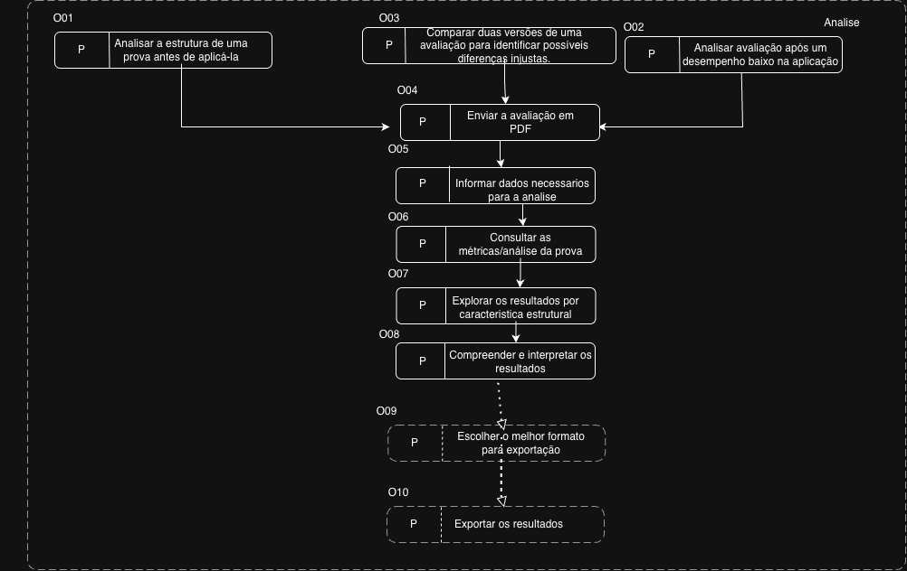

# Entrega 9 — Modelo conceitual e design centrado na comunicação

**Data:** 25/10/2026  
**Status:** 🟩 Concluída  
**Responsabilidade:** soluções individuais, com consolidação da equipe para mapa de objetivos e esquema de signos.

## Objetivo da atividade

Passar do cenário de problema para uma concepção da interação, explicitando objetivos, tópicos de conversa, falas e signos que a interface deverá comunicar/manipular.

## 1. Cenários de interação

Para cada cenário de problema, produza uma versão em que a solução já pode ser descrita. **Destaque claramente o texto alterado** em relação ao cenário original.

### CI01 — Professor percebe um desempenho inesperadamente baixo

**Autor(a):** Luana Bortko Rodrigues **RA:** 24.123.006-9 
**Origem:** cenário problema C01 - Professor percebe um desempenho inesperadamente baixo

Maria da Costa Silva é professora de Literatura do ensino médio em uma escola pública do estado de São Paulo. Após corrigir uma avaliação aplicada recentemente a uma de suas turmas, percebe que o desempenho dos estudantes foi consideravelmente inferior ao esperado. Durante as aulas e atividades realizadas ao longo do período, a maioria dos alunos demonstrava compreender os conteúdos trabalhados e conseguia participar das discussões e dos exercícios propostos.

Diante desse resultado, Maria começa a questionar se a dificuldade apresentada pelos estudantes está relacionada à falta de domínio dos conteúdos ou se características da própria avaliação podem ter influenciado a resolução das questões. Ao revisar a prova, observa que algumas questões possuem enunciados extensos, diferentes quantidades de texto, elementos visuais e posições distintas. Ela considera que esses aspectos podem ter dificultado a interpretação ou a resolução de determinadas questões, mas não dispõe de informações suficientes para determinar se existe alguma relação entre essas características e o desempenho da turma.

Para compreender melhor a situação, Maria **decide utilizar um sistema de análise de avaliações para examinar a prova de forma objetiva e obter informações que orientem a revisão de suas próximas avaliações, em vez de depender apenas de impressões e conversas informais com colegas.**

[Q1] Para iniciar essa investigação, Maria, com acesso à versão digital **em pdf de sua avaliação conecta na ferramenta de análise e realiza o envio do arquivo PDF de sua avaliação. O sistema valida as precondições do documento e fornece o feedback de que o arquivo está pronto para o processamento.**

[Q2] Maria precisa compreender quais conhecimentos e informações são necessários para utilizar a ferramenta e interpretar os resultados apresentados. **O sistema exibe orientações contextuais e explicações acessíveis sobre o significado das métricas estruturais e estatísticas, auxiliando Maria a interpretar as informações sem exigir conhecimentos avançados de análise de dados.**

[Q3] Para investigar a situação, Maria **seleciona na interface a análise das características estruturais da prova, como extensão dos enunciados e presença de imagens. O sistema processa esses dados e apresenta visões organizadas que relacionam essas características com o desempenho observado na turma.**

[Q4] Essa investigação ocorre após a correção da avaliação, durante o período em que Maria planeja as próximas atividades e avaliações. Ela **realiza essa interação diretamente no ambiente do sistema durante seu horário de planejamento na escola.**

[Q5] Maria dispõe de um computador ou notebook na escola e de uma cópia digital da avaliação em PDF. **Para acomodar sua rotina atarefada, o sistema oferece uma interação ágil e direta, permitindo que ela conclua a consulta e a interpretação dos dados em pouco tempo.**

[Q6] Para avaliar se a análise foi útil, Maria **examina as analises geradas pelo sistema e julga se os dados oferecem insights relevantes. O sistema comunica o significado dos indicadores de forma clara, destacando pontos de atenção na prova sem sugerir relações precipitadas de causalidade.**

[Q7] Durante a análise, **se o arquivo enviado contiver inconsistências ou formatação incompatível, o sistema interrompe o processamento, exibe uma mensagem de erro explicativa.** Além disso, a proximidade do planejamento das próximas avaliações pode tornar necessário reorganizar suas prioridades e o tempo dedicado à investigação.

[Q8] Ao realizar a análise, Maria **utiliza as opções de navegação oferecidas pela interface para definir seu percurso de investigação.** Ela pretende direcionar seus esforços aos aspectos que considera mais relevantes para compreender as dificuldades observadas durante a correção e, a partir das informações obtidas, decidir quais pontos da avaliação merecem ser revistos.

Maria considera que terá alcançado seu objetivo **quando o sistema lhe fornecer uma interpretação clara das características da prova, permitindo identificar pontos que mereçam uma revisão mais cuidadosa e tomar decisões fundamentadas na elaboração de suas futuras avaliações.**

### Diferenças relevantes

| Alteração | Por que foi necessária | Evidência/artefato que justifica |
|---|---|---|
| Substituição de buscas informais pelo uso do sistema | Introduzir a solução de software como meio sistemático para investigar as características da avaliação. | H02, H03, H08 |
| Upload do PDF e validação inicial pelo sistema | Permitir a entrada de dados e fornecer feedback imediato de visibilidade do estado do sistema. | R02, F02, protótipo |
| Apresentação de guias de interpretação pelo sistema | Ajudar a usuária na compreensão das métricas sem exigir conhecimento prévio avançado em estatística. | F03, R03, H06, protótipo |
| Seleção interativa das características estruturais, como extensão de enunciados e imagens| Substituir a observação manual da prova por um fluxo interativo, em que a usuária aciona o recorte desejado (estímulo) e o sistema responde exibindo visualizações organizadas de desempenho (feedback/mudança de estado). | R04, R01, protótipo |
| Execução da análise via sistema no horário de planejamento e ambiente escolar | Adequar o uso da interface ao contexto real de trabalho e à rotina atarefada da professora, oferecendo um fluxo rápido de envio e consulta que respeite sua limitação de tempo. | H05 |
| Exibição das analises | Apoiar a tomada de decisão da usuária fornecendo indicadores claros para avaliar a utilidade da análise, ressaltando que métricas são pontos de reflexão e não prova de causa. | H08, R01, R04, F01, protótipo |
| Emissão de mensagens de erro explicativas | Avisar de forma clara erros que acontecem no input (ex: formato da prova incompativel, tempo de prova ultrapassou o limite)| protótipo |
| Obtenção de diagnósticos claros do sistema para orientar revisões de provas futuras | Conectar o feedback final do sistema ao alcance do objetivo principal da persona | H02, H03, H08, F01, R01, R04, protótipo |

### CI02 — Professor quer verificar uma prova antes de aplicá-la

**Autor(a):** Beatriz Manaia Lourenço Berto **RA:** 22.125.060-8  
**Origem:** cenário problema C02 - Professor quer verificar uma prova antes de aplicá-la.

Maria da Costa Silva é professora de Literatura do ensino médio em uma escola pública do estado de São Paulo e, cerca de duas semanas antes da aplicação das avaliações, começa a elaborar uma prova para uma de suas turmas. Para isso, utiliza como referência os conteúdos trabalhados em aula, questões de provas anteriores, suas próprias anotações, materiais didáticos e as principais dúvidas apresentadas pelos alunos ao longo do período. A partir desses materiais, busca construir questões alinhadas aos conteúdos e objetivos de aprendizagem trabalhados em sala.

[Q2] Para iniciar a elaboração e a revisão da avaliação, Maria precisa ter definido os conteúdos que pretende avaliar, dispor dos materiais de referência necessários e ter acesso aos recursos que utiliza para preparar suas provas. Também precisa conhecer os objetivos de aprendizagem da turma para que possa verificar se as questões estão alinhadas ao que foi trabalhado em aula.[Q2-interação]Além disso, Maria pode utilizar o sistema DesemProv (de avaliação de analise estrutural da prova) para apoiar a revisão da atividade. Para que a avaliação seja processada e suas métricas extraídas com sucesso, estabelece-se como pré-condição que o arquivo enviado esteja em formato PDF, contenha questões de múltipla escolha e atenda aos requisitos estruturais da plataforma. Ademais, é obrigatório o preenchimento de informações essenciais da prova (como o tempo de duração e o número total de questões), enquanto os demais dados permanecem como opcionais, conforme a disponibilidade do docente.

[Q4] Maria prepara e revisa suas avaliações utilizando os recursos disponíveis em sua rotina de trabalho. Também pode utilizar plataformas educacionais, para organizar e disponibilizar materiais aos alunos, ferramentas para elaborar questionários e avaliações e ferramentas de inteligência artificial, para auxiliar na elaboração, adaptação ou revisão de questões. A escolha desses recursos depende das necessidades da atividade e de sua familiaridade com as ferramentas disponíveis.[Q4-interação]Os docentes podem utilizar o DesemProv, um sistema web para análise estrutural de provas, antes ou após a aplicação das avaliações. Antes da aplicação, a ferramenta é utilizada para compreender características estruturais da prova (como quantidade de caracteres, presença de imagens, formalismo, distribuidores/distratores e tempo estimado de leitura) e compará-las com os impactos observados em questões do ENEM. Isso facilita a compreensão global da avaliação e apoia o refinamento prévio dos itens.

[Q1] Durante a preparação da prova, Maria organiza suas atividades em etapas. Inicialmente, define o formato da avaliação, a quantidade de questões e os conteúdos que pretende avaliar. Em seguida, consulta os materiais de referência, elabora ou adapta as questões e organiza uma primeira versão da prova. Depois, revisa os enunciados, verifica a clareza das questões e a coerência das alternativas e realiza alterações quando identifica possíveis problemas. Por fim, pode solicitar que outros professores revisem a avaliação e compartilhem suas opiniões antes da aplicação.[Q1-interação]Buscando uma análise mais aprofundada e objetiva do que a mera opinião de um colega, o docente realiza o upload da avaliação em formato PDF no sistema DesemProv. Após o envio, a aplicação processa o arquivo e retorna gráficos e métricas que permitem compreender a distribuição estrutural da prova, bem como avaliar o impacto potencial dessas características com base nos dados de referência do ENEM. Desse modo, Maria consegue examinar criticamente as propriedades de sua avaliação e decidir fundamentadamente sobre a necessidade de correções.

Após preparar uma primeira versão da avaliação, Maria inicia um processo de revisão cuidadoso. Relê os enunciados, verifica se estão claros e objetivos, se apresentam ambiguidades, se as alternativas são coerentes e se as questões realmente avaliam os conteúdos que deseja verificar. Também observa características como a extensão dos textos, a quantidade de informações apresentadas e o nível de interpretação exigido, buscando evitar que aspectos relacionados à estrutura das questões interfiram indevidamente no desempenho dos alunos.

[Q6] Para realizar essa revisão, Maria precisa conhecer os conteúdos da disciplina, os objetivos de aprendizagem trabalhados em aula e os princípios de elaboração de questões, como clareza, correção textual, identificação de ambiguidades e adequação entre a questão e o conteúdo que se pretende avaliar. Caso utilize uma ferramenta de análise estrutural, também precisará compreender quais informações deve fornecer e como interpretar as métricas apresentadas.

[Q3] Maria busca elaborar avaliações adequadas porque deseja obter informações confiáveis sobre o conhecimento dos alunos e utilizar essas informações para aprimorar suas aulas. Para isso, precisa compreender os conteúdos que pretende avaliar, conhecer as dificuldades que observa durante as aulas e saber quais características da elaboração de questões podem merecer atenção. Seu conhecimento da disciplina e de sua turma contribui para que tome decisões coerentes com os objetivos de aprendizagem.[Q3-interação]Para utilizar o sistema e analisar a prova, o docente precisa conhecer detalhadamente as informações da avaliação que elaborou para preencher corretamente os inputs. Ademais, após o sistema retornar as métricas em formatos visuais e gráficos, é necessário que o professor possua capacidade analítica para interpretar os resultados ou, ao menos, compreender as informações de suporte textuais fornecidas pela plataforma.

[Q5] Sua experiência como professora e seu conhecimento dos conteúdos podem facilitar a elaboração e a revisão da avaliação. Por outro lado, o tempo limitado para preparar as provas e a dificuldade de identificar objetivamente quais características estruturais podem estar associadas ao desempenho dos estudantes podem dificultar a identificação de aspectos que mereçam uma análise mais aprofundada.[Q5/Q6-interação] Para interagir com a ferramenta, o docente precisa ser organizado na reunião prévia dos dados exigidos pela plataforma (como tempo de duração, gabarito e nível de dificuldade das questões) e apresentar uma habilidade básica de interpretação. Para auxiliar nesse processo, o sistema não apenas retorna as representações gráficas, mas também fornece descrições detalhadas e explicações textuais sobre os dados apresentados, servindo como um guia para apoiar o professor na leitura e compreensão dos resultados.

[Q8] Durante a preparação da avaliação, acontecimentos inesperados, como uma alteração no prazo de entrega da prova estabelecido pela escola ou uma mudança nos conteúdos que precisam ser contemplados, podem exigir que Maria reorganize suas prioridades, altere algumas questões ou modifique o planejamento da revisão. Essas situações podem reduzir o tempo disponível para a atividade e exigir adaptações na forma como ela conduz a preparação da avaliação.[Q8-interação] Ao utilizar o DesemProv para analisar sua avaliação, Maria pode identificar, por meio das métricas retornadas, que certas características estruturais (como textos excessivamente longos ou de alto formalismo) estão muito presentes. Com base nesses insights objetivos sobre o impacto potencial dos itens, ela pode decidir modificar questões específicas antes da aplicação da prova.

[Q7] Maria pode avaliar se a prova está pronta para ser aplicada verificando se as questões estão alinhadas aos conteúdos e objetivos de aprendizagem, se os enunciados são claros e se as alternativas são coerentes. As opiniões dos professores que colaboram na revisão também podem ajudá-la a identificar problemas que não havia percebido. Caso utilize uma ferramenta de análise estrutural, precisará interpretar os resultados e julgar se eles fornecem informações relevantes para revisar a avaliação. Após a aplicação, o desempenho dos alunos e as dúvidas apresentadas poderão contribuir para avaliar suas escolhas, embora esses dados, isoladamente, não comprovem que determinadas características estruturais causaram dificuldades.[Q7-interação] O objetivo é considerado concluído quando o sistema fornece as métricas detalhadas, as informações gerais e as descrições dos gráficos. A partir disso, cabe ao professor utilizar os resultados gerados pela ferramenta para analisar criticamente a sua prova, refletindo sobre a necessidade de implementar modificações estruturais antes de aplicá-la aos alunos.

Entretanto, mesmo após essas etapas, a análise da avaliação continua baseada principalmente na experiência e na percepção dos professores. Maria não possui uma forma objetiva e baseada em dados de verificar se determinadas características estruturais das questões, como a extensão dos enunciados, a quantidade de informações apresentadas ou o nível de interpretação exigido, podem estar associadas ao desempenho dos estudantes. Dessa forma, embora consiga avaliar as questões sob diferentes perspectivas, permanece sem evidências suficientes para identificar quais características da estrutura da prova merecem atenção antes de sua aplicação.

<!--le ate achar onde entra o sistema e add a info na interface, responde essas perguntas com base na interface

| # | Questão | Por que precisa ser respondida | Fonte/forma de obter resposta |
|---|---|---|---| 
| Q1 | [Planejamento] Quais os detalhes sobre a sequência de ações que compõe uma atividade? | Para ajudar no refinamento do cenário inicial | hipotese |     
| Q2 | [Objetivos] Quais as precondicoes para esse objetivo? | Para ajudar no refinamento do cenário inicial | hipotese |
| Q3 | [Atores] De que informações ou conhecimentos os atores precisam para realizar esse objetivo? | Para ajudar no refinamento do cenário inicial | hipotese |
| Q4 | [Ambiente ou contexto] Quais são as técnologias utilizadas no ambiente de trabalho? Como os usuários as utilizam? | Para ajudar no refinamento do cenário inicial | hipotese |
| Q5 | [Atores] Quais características do(s) ator(es) lhes auxiliam ou atrapalham em alcançar o objetivo? | Para ajudar no refinamento do cenário inicial | hipotese |
| Q6 | [Ações] De que informações ou conhecimento os atores precisam para realizar essa ação? | Para ajudar no refinamento do cenário inicial | hipotese |
| Q7 | [Avaliação] Como os atores conseguem saber se o objetivo foi concluído e alcançado com sucesso? | Para ajudar no refinamento do cenário inicial | hipotese |
| Q8 | [Evento] Que acontecimentos inesperados durante a preparação da avaliação poderiam levar Maria a alterar as questões ou modificar o planejamento da revisão? | Identificar acontecimentos que possam modificar o andamento da atividade ou exigir mudanças no que havia sido planejado. | hipotese |
-------

-->

### Diferenças relevantes
<!-- identifica onde cenario problema vira interacao, de q parte passa a vira iteracao-->
| Alteração | Por que foi necessária | Evidência/artefato que justifica |
|---|---|---|
| Q1-interação | Porque o sistema DesemProv fornece uma forma mais estruturada, precisa e baseada em dados para o docente analisar as características formais da avaliação, indo além da dependência exclusiva da opinião de colegas. | Goms, CTT, Protótipo |
| Q2-interação | Pois detalha quais são as pré-condições técnicas e de dados necessárias para o uso do sistema de análise estrutural de provas (DesemProv). | R02, protótipo |
| Q3-interação | Ao compreender o que o usuário precisa para alcançar o objetivo dentro do sistema, conseguimos fornecer essas informações de suporte na aplicação para otimizar e agilizar as funções do usuário, ou apenas informá-lo de sua necessidade, tornando o sistema cada vez mais intuitivo e eficiente. | H04, H06, H07, R03 |
| Q4-interação | Ao fornecer o DesemProv para os docentes analisarem as características estruturais de suas provas, bem como o possível impacto dessas características, cria-se um método baseado em dados e estudos, sendo muito mais comprovado do que apenas pedir a opinião e contar com a disponibilidade de colegas. | F01, F02, H08, H11 |
| Q5/Q6-interação | Para identificar as características dos atores (como a necessidade de organização e habilidade básica de interpretação) e as informações de suporte que o sistema deve fornecer (como descrições detalhadas dos gráficos) para ajudá-los a alcançar o objetivo com sucesso. | H06, H08, R01, R03 |
| Q7-interação | Para definir o critério de conclusão do objetivo com o auxílio do sistema (fornecimento de métricas e descrições gráficas), permitindo que o docente saiba o momento exato em que a análise estrutural foi entregue para apoiar sua tomada de decisão crítica. | HTA, GOMS, CTT, H01, H02, H03, H08 |
| Q8-interação | Para prever como o próprio feedback do sistema (as métricas e o impacto potencial de características como formalismo e extensão de texto) pode atuar como um evento inesperado que motiva o docente a modificar e refinar questões específicas antes da aplicação da prova e ajuda a prepararmos o sistema com base no que motiva o usuário a usá-lo | GOMS, CTT, Concorrência, H10, H11 |

### CI03 —  Professor quer comparar duas versões de uma avaliação

**Autor(a):** Nuno Martins Guilhermino da Silva **RA:** 22.126.099-5 
**Origem:** cenário problema C03 - Professor quer comparar duas versões de uma avaliação

{{cenário de interação com alterações marcadas}}

Vera é professora de inglês e preparou duas versões de uma avaliação para aplicar em turmas diferentes, buscando evitar o compartilhamento de respostas entre os alunos. Ela deseja verificar se as diferenças entre as versões podem fazer com que uma das turmas seja favorecida ou prejudicada.

**Por possuir acesso a um computador com internet, Vera decide utilizar o sistema DesemProv para comparar as duas avaliações de forma rápida e objetiva.**

[Q1] Para realizar a comparação, Vera pode precisar considerar os conteúdos avaliados, os objetivos de aprendizagem e as características das turmas, além de reconhecer quais aspectos da estrutura das questões merecem atenção. Os conhecimentos e critérios que ela efetivamente utiliza ainda precisam ser investigados.

**[Q1] Vera acessa a plataforma e realiza o upload dos PDFs das duas versões da prova. O sistema processa os arquivos e extrai automaticamente métricas estruturais como contagem de palavras, presença de imagens, nível de formalidade e tempo estimado de leitura.**

[Q2]A comparação ocorre no contexto de preparação das avaliações, antes de sua aplicação. [Q5]**Para mitigar a pressão dos prazos de entrega e a rotina corrida de aulas, [Q3]Vera utiliza seu computador com acesso à internet para enviar os PDFs à aplicação. O sistema realiza o processamento automatizado das duas versões em poucos segundos, fornecendo um relatório comparativo direto que elimina a necessidade de revisões manuais demoradas.**

**[Q8]Ao visualizar o painel comparativo, Vera observa alertas visuais indicando as principais discrepâncias entre as provas. O sistema exibe explicações acessíveis em linguagem natural sobre o impacto de cada métrica no desempenho dos estudantes. [Q11] Vera utiliza esses dados como apoio pedagógico para identificar quais questões precisam de ajuste para equilibrar o nível de exigência entre as turmas.**

[Q4] [Q6] Os resultados da comparação podem ser úteis para Vera na revisão das avaliações e, indiretamente, para os alunos que realizarão as provas. Também é necessário investigar se outras pessoas participam do processo, utilizam seus resultados ou fornecem informações que auxiliam a análise.

[Q10] Durante a preparação, acontecimentos não previstos podem exigir mudanças no planejamento ou nas avaliações.**Se um dos arquivos contiver formatação incompatível, a plataforma interrompe a análise e exibe uma mensagem explicativa orientando o envio correto do documento.**

[Q9] Ao final da comparação, Vera precisa avaliar se as diferenças identificadas foram tratadas adequadamente e se dispõe de informações suficientes para decidir que as avaliações estão prontas para aplicação.**Vera reanalisa as provas na aplicação e verifica que as disparidades foram corrigidas.**

**Após revisar as diferenças apresentadas e realizar as alterações que considera necessárias, Vera utiliza as informações obtidas na comparação, juntamente com seus critérios pedagógicos, para avaliar se as duas versões estão adequadas para aplicação nas respectivas turmas.**

**Com o auxílio da aplicação, Vera consegue visualizar de maneira organizada as diferenças estruturais entre as duas avaliações. Essas informações auxiliam sua revisão e permitem que ela identifique questões que podem precisar de alterações antes da aplicação das provas, sem substituir seus próprios critérios pedagógicos.**
### Diferenças relevantes

| Alteração | Por que foi necessária | Evidência/artefato que justifica |
|---|---|---|
| Introdução da Solução | Definir a tecnologia de suporte e o canal de interação, superando a análise manual do cenário problema. | Persona P03 (Vera), Protótipo em Papel. | 
| Q1 | Especificar a entrada de dados via PDF e a extração automatizada de métricas estruturais (extensão, imagens, formalidade, tempo de leitura). | HTA, CTT, GOMS, F01, F02, Protótipo. | 
| Q2, Q3, Q5 | Esclarecer a infraestrutura de uso e demonstrar como o processamento automatizado reduz a pressão de tempo na rotina corrida da docente. | Persona P03, Entrega 7, HTA, CTT. | 
| Q8, Q11 | Mostrar como o sistema apresenta alertas visuais e descrições em linguagem natural, auxiliando na priorização e na decisão pedagógica de revisão. | H01, H02, H06, H08, H10, GOMS, CTT. | 
| Q4, Q6 | Demonstrar como a ferramenta assegura a equivalência estrutural entre as provas aplicadas em turmas diferentes. | Análise de Concorrência, Requisitos do Sistema. | 
| Q10 | Mapear o tratamento de falhas e exceções (ex.: arquivo incompatível), fornecendo feedback e instrução clara de recuperação. | H05, H09,CTT. | 
| Q9 | Definir o critério objetivo de conclusão da tarefa através da reanálise no sistema e confirmação do equilíbrio das versões. | HTA, CTT. |

## 2. Design centrado na comunicação

**Nome do cenário:** CI01

| Tópico > subtópico | Falas e signos envolvidos | Intenção/efeito esperado |
|---|---|---|
| Analisar prova com desempenho abaixo do esperado | `U: Quero analisar minha avaliação recente para identificar características da prova que possam ter dificultado a resolução das questões pelos alunos.` | Estabelecer o objetivo da interação e apresentar ao usuário as possibilidades de análise oferecidas pelo sistema. |
| > Enviar e validar avaliação |`U: Vou enviar o arquivo PDF da avaliação.` / `D: Arquivo recebido. O documento foi validado e está pronto para análise.` | Permitir que Maria forneça o documento necessário e informar o resultado da validação, dando visibilidade ao estado do sistema. |
| > Tratar problemas no upload | `U: Tento enviar um arquivo PDF, mas o sistema não consegue identificar seu conteúdo.` / `D: Não foi possível extrair o texto do documento. Verifique se o arquivo está em um formato compatível e tente enviá-lo novamente.` | Comunicar a ocorrência de um problema, explicar sua possível causa e orientar Maria sobre como prosseguir. |
| > Compreender as métricas | `U: O que significam as métricas apresentadas na análise?` / `D: As métricas apresentam características da avaliação, como extensão dos textos, quantidade de caracteres e presença de elementos visuais. Os resultados ajudam a identificar aspectos que podem merecer atenção, mas não comprovam, isoladamente, que essas características causaram o desempenho observado.` | Explicar os conceitos utilizados pelo sistema e auxiliar Maria na interpretação dos resultados, sem exigir conhecimento técnico avançado. |
| Explorar os resultados da avaliação | `U: Quero ver os resultados da minha analise` / `D: Ok, a analise foi concluida, voce ja pode acessar os resultados como preferir` | Permitir que Maria explore diferentes características estruturais da prova |
| > Filtrar análises por característica | `U: Quero filtrar a visualização para exibir apenas os indicadores de [característica da prova] (ex: formalismo, extensão de texto, elementos visuais).` / `D: Filtro de [característica da prova] aplicado. Exibindo o recorte das questões correspondentes e suas taxas de desempenho.` | Permitir que Maria selecione e alterne entre as diferentes características estruturais e pedagógicas da avaliação, isolando variáveis para investigar suas hipóteses. |
| > Interpretar diferenças e pontos de atenção | `U: Como posso interpretar essas informações?` / `D: As características apresentadas permitem observar diferenças entre as questões. Elas devem ser consideradas em conjunto com o conteúdo avaliado e os objetivos de aprendizagem, pois uma característica estrutural, isoladamente, não determina a dificuldade de uma questão.` | Apoiar a interpretação dos resultados e evitar conclusões precipitadas sobre a relação entre estrutura da prova e desempenho dos alunos. |

**Nome do cenário:** CI02

| Tópico > subtópico | Falas e signos envolvidos | Intenção/efeito esperado |
|---|---|---|
| Analisar a estrutura de uma prova antes de aplicá-la | `U: Quero analisar a avaliação que acabei de elaborar para identificar características estruturais que possam impactar o desempenho dos meus alunos`| Estabelecer o objetivo da interação e apresentar a finalidade da ferramenta permitindo que o docente compreenda como a análise pode apoiar a revisão da avalia˜so antes de sua aplicação. |
| > Enviar a avaliação |  `D: Envie um arquivo contendo sua prova de múltiplaescolha em formato PDF ` / `U: Vou enviar o arquivo da nessas especificações` / `D: Arquivo recebido e dentro dos conformes. Informe os dados necessários para realizar a análise` | Permite que o docente forneça o documento que será analisado e informar o resultado da validação inicial, dando visibilidade ao estado do sistema. |
| > Informar dados da avaliação para iniciar a análise | `D: Qual a duração da avaliação? Qual a dificuldade das questões? Que tipo de anaálise deseja?`/ `U: 2h, as primeiras 5 questões são fáceis e as demais médias. Desejo realizar todas as análises disponíveis.` / `D: Informações obrigatórias preenchidas, documento enviado para a análise, aguarde um momento.` | Solicita as informações complementares necessárias para configurar a análise e garantir que o sistema disponha dos dados exigidos para o processamento. |
| > Consultar as métricas/análise da prova | `U: Quero visualizar as métricas e características estruturais da minha avaliação `/ `D: A análise apresenta gráficos com métricas como extensão dos enunciados, tempo gasto para leitura da avaliação, formalismo das questÕes, além de trazer uma análise da correlação entre as características como distrator e caracter e o desempenho dos candidatos.` | Apresenta as características identificadas na prova, permitindo que o docente compreenda sua composição estrutural e identifique possíveis pontos de atenção. |
| > Compreender e interpretar os resultados | `U: Como posso interpetar melhor essas métricas e gráficos para entender sua relação com o desempemho?`/ `D:Pode ler os detalhamentos de cada gráfico bem como suas descricÕes para entender de uma maneira mais clara como eles funcionam` / `U: Cosnegui compreender melhor agora`| Oferece informações de apoio para facilitar a interpretação dos resultados, permitindo que o docente compreenda os indicadores e utilize-os como subsíidio para revisar sua avaliação. |
| Exportar resultados da análises | `U: Quero exportar os resultados para consultá-los posteriormente`/ `D: Você pode escolher o formto de exportação disponível para salvar sua análise` | Permitir que o docente obtenha os resultados da análise em um arquivo, facilitando sua consulta e utilização posterior. |
| > Escolher o melhor formato para exportação | `D: Em qual formato deseja exportar os resultados?` / `U: Quero exportar a análise em PDF`/ `D: Arquivo gerado, a análise está disponível para consulta.` / | Permite que o docente escolha o formato de saída e informe a conclusão da exportação |

**Nome do cenário:** CI03

| Tópico > subtópico | Falas e signos envolvidos | Intenção/efeito esperado |
|---|---|---|
| Comparar duas versões de uma avaliação | `U: Quero comparar duas versões da minha avaliação para verificar se o nível de exigência está equivalente entre as turmas. `  | Estabelecer o objetivo da interação. |
| > Enviar e validar primeira avaliação (Versão A)| `U: Vou enviar o arquivo PDF da Versão A da avaliação.` \ `D: Arquivo recebido. O documento foi validado e as métricas estruturais da Versão A foram geradas.` | Permitir o envio da primeira prova, confirmando a validação do documento e exibindo seus resultados estruturais. |
| > Enviar e validar primeira avaliação (Versão B)| `U: Agora quero enviar o PDF da Versão B.` \ `D: Arquivo recebido. O documento foi validado e as métricas estruturais da Versão B foram geradas.` | Permitir o envio da segunda prova, confirmando a validação do documento e exibindo seus resultados estruturais. |
| Explorar e comparar os relatórios de métricas | `U: Quero consultar os resultados das duas avaliações.` `D: Os relatórios apresentam as métricas estruturais de cada avaliação, acompanhadas de descrições que auxiliam sua interpretação..` | Permitir que Vera consulte os relatórios de cada prova e compare suas características estruturais para identificar possíveis desequilíbrios. | 
| > Interpretar pontos de atenção e decidir ajustes | `U: Vou verificar e comparar as métricas das duas avaliações para ver se farei edições.`  | Apoiar Vera na interpretação pedagógica dos dados para que ela decida, com autonomia, qual versão necessita de alterações. | 
| Reanalisar a avaliação ajustada| `U: Fiz alterações na Versão A e quero analisá-la novamente para verificar suas características estruturais` `D: A avaliação foi processada novamente. O relatório atualizado está disponível para consulta.` | Permitir que Vera obtenha novas métricas após realizar alterações na avaliação. | 
| > Concluir a comparação e reanalisar prova ajustada | `U: Consultei os relatórios e quero decidir se as duas versões estão adequadas para aplicação.` `D: Reanálise concluída. Os novos relatórios foram feitos e podem ser usados.` | Finalizar o ciclo de revisão e apoiar a tomada de decisão final da docente. |

**Convenção:** `U` = usuário; `D` = preposto do designer/sistema, conforme a abordagem de Engenharia Semiótica adotada na disciplina.

<!-- mapa eh 1 p equipe toda-->

## 3. Mapa de objetivos

Cada integrante apresenta seu mapa e a equipe cria um **mapa consolidado**, eliminando duplicidades e resolvendo conflitos de nomenclatura.

<!--

organizar os objetivos dos usuários identificados na análise

oq user deseja realizar, nao considero COMO realiza

-->

<!--  Se eu preciso faze tudo em ordem as etapas tem q ser fluxo de obj leva seta pras atividades mostra q cada seta entr obj e atividade a atividade ja concretiza o obj 

Se for atividade q eu faço e saio do sistema dps 
Ex abri moodle e ele habilita ou n notificação se clicamos no video, isso eh obj instrumental de configuração  que dá bônus que permite alcança obj final, configura usuário n eh objetivo mas ajuda a entender obj.(tracejado)

Caixa tracejada eh so se eh instrumental

Arruma fluo das caixas e caixa cheia pras q n eh instrumental 

Ligação entre caixas da o fluxo: pelo diagrama de obj vemos oq precisa faze p chega em obj -->

### Dicionário de objetivos do mapa consolidado <!-- mapa eh 1 p equipe toda-->

| ID | Objetivo | Persona(s) | Cenário(s) | Prioridade |
|---|---|---|---|---|
| O01 | Analisar a estrutrua de uma prova antes de aplicá-la  | P01 - professor | CI02 | Alta |
| O02 | Analisar uma avaliação após identificar um desempenho abaixo do esperado  | P01 - professor | CI01 | Alta |
| O03 | Analisar duas provas para verificar se não há discrepâncias de exigência| P01 - professor | CI03 | Alta |
| O04 | Enviar a avaliação em PDF | P01 - professor | CI01, CI02, CI03 | Alta |
| O05 | Informar os dados necessários para a análise | P01 - professor | CI01, CI02, CI03 | Alta |
| O06 | Explorar os resultados por característica estrutural | P01 - professor | CI01, CI02, CI03 | Alta |
| O07 | Consultar as métricas e a análise da prova | P01 - professor | CI01, CI02, CI03 | Alta |
| O08 | Compreender e interpretar os resultados | P01 - professor | CI01, CI02, CI03 | Alta |
| O09 | Exportar os resultados | P01 - professor | CI01, CI02, CI03 | Baixa |
| O010 | Escolher o formato de exportação | P01 - professor | CI01, CI02, CI03| Baixa |

## 4. Esquema conceitual de signos
<!--unico e alinhamento ebatido entre todos escolher , ipload,td input e output sao signos, se tem sinalizacao do sistem a eh sigo baseado so na parte de analise da tela é sobre obj ex analise de prova vai ter mtoo signos, dado exibidos e tem grupos de signos (grupo da prova, da área...  -->

Conforme alinhado em sala, na nossa aplicação de alto nível existem 3 telas no total (análise, ENEM, e sobre) porém as telas ENEM e sobre não fazem parte da analise conceitual pois não entram no escopo principal estudado na matéria de ihc, que é analisar a prova em diferentes cenários, objetivo esse relacionado a tela "análise", ou seja, agrega mais valor ao proj faze o da analise)

Consolide as informações em **uma tabela única**.

| Grupo | Signo | Origem | Observações/semântica | Tipo de conteúdo | Restrição | Valor padrão | Prevenção | Recuperação |
|---|---|---|---|---|---|---|---|---|
| Análise | Prova | Domínio | Avaliação elaborada pelo professor, composta por questões de múltipla escolha, enunciados e alternativas. é o documento fornecido pelo usuário que será processado pelo Desemprov para extração de características estruturais e análises comparativas com o ENEM | Documento digital(PDF), contendo textos e, eventualmente imagens. | Arquivo obrigatório, formato PDF e tamanho máximo de 10 MB. Deve atender aos requisitos da ferramenta | nenhum | Informar os formatos aceitos e o limite de tamanho antes do envio, validar o arquivo selecionado antes de iniciar o processamento | Exibir mensagem explicativa caso o arquivo seja inválido ou não possa ser processado, permitindo que o professor envie outro documento. |
| Análise | Área tracejada (dropzone) | Convencional | Delimitação da área de soltura do arquivo, atua como limite da zone de transferência | Controle de interface (visual) | nenhum | nenhum | Drag uda de cor ao arrastar um arquivo |  nenhum|
| Análise | ícone de upoad (seta) | Convencional | Representação visual da ação de transferir m arquivo do dispositivo local para o sistema | visual(ícone) | nenhum | nenhum | nenhum | nenhum |
| Análise | Texto instrucional | Convencional | Explica de forma textual direta as formas de interação possíveis com o componente | textual | nenhum | texto "Selecione ou arraste um arquivo" | nenhum | nenhum |
| Análise | Texto de restrição | Aplicação | Signo preventivo, comunica as regras do sistema antes do usuário tentar enviar, reduzindo frustração | textual | limite de 10 MB e extensão PDF | texto "Formato aceito: PDF de até 10 MB" | nenhum | previnir envio de arquivo errado|
| Análise | Botão "Escolher arquivo" | Convencional | Comando, aciona gatilho para abrir o gerenciador de arquivos do SO | botão | Deve permitir selecionar apenas arquivos compatíveis (PDF) | Texto "Escolher arquivo" | habilitar apenas os formatos aceitos na tela | permitir clicar novament epara selecionar outro arquivo, substituindo o selecionado previamente |
| Análise | Informações do arquivo (nome e tamanho) | Aplicação | Conteúdo de confirmação/validação do usuário | Informacional | nenhum |. <nome do arquivo>.pdf <tamanho do arquivo> | nenhuma | nenhuma |
| Análise | Botão "cancelar" | Convencional | Botão para controle de exclusão de arquivo com "X"e fundo vermelho | Botão de ícone | Só aparece junto ao arquivo carregado "Informações do arquivo (nome e tamanho)" | "X" | nehuma | Ação de recuperação pois ao clicar e mexlcuir apaga arquivo atual e deixa visível apenas campos/dados de envio |
| Análise | Erro1: Formato inválido | Aplicação | Interurpção, modal bloqueia a tela para avisar que arquivo não é um PDF e necessita correção imediata | Modal com texto explicativo | Disparado ao tentar subir um arquivo com extensão errada | Oculto | O texto "Formato aceito: PDF"na tela principal tenta evitar esse erro | Ação de recuperação ao clicar em botão "x" ou "Entendido"|
| Análise | Erro2: Erro ao preparar a análise | Aplicação | Falha no processamento, um banner inline na página avisando que não foram encontradas questÕes no arquvio de formato válido | Banner de alerta com texto e botão "Tentar novamente" | Disparo quando o processamento do PDF não encontra questÕes válidas | Oculto | Instruir no texto da tela que deve ser enviado um PDF com questões | Ação de recuperar, botão "Tentar novamente" ou "x"para fechar banner que permite usuário inserir novo arquivo |
| Análise | Erro3: Arquivo excede tamanho | Aplicação | Restrição de sistema, avisa que arquivo escolhido tem mais de 10 MB | Textual (mensagem de erro) | Disparo se arquivo anexado for maior que 10 MB | Oculto | Aviso preventivo na tela principal "até 10 MB"| Ação de recuperação, usuári odeve fechar aviso e selecionar um arquivo menor |
| Análise | Erro4: Server Error | Aplicação | Falha sistêmica, comunica que o problema é instabilidade na ferramenta | Banner/ popUp de alerta com ícone de falha e botão "Tentar novamente" | Disparado quando a requisição falhar | Oculto | nenhum | Ação de recuperação, botão "Tentar novamente"para refazer a requisição |
| Análise | Tipo de análise | Aplicação | Define qual análise estrutural o professor deseja realizar. | Seleção (lista de opções). | Deve selecionar uma opção disponível. | Análise Completa. | Apresentar as análises disponíveis. | Permitir selecionar outra(s) análise(s). |
| Análise | Duração da prova | Domínio | Tempo total disponibilizado para a realização da avaliação. | Numérico (horas e minutos). | Obrigatório; valores válidos de duração. | Nenhum. | Indicar os campos de horas e minutos e validar os valores. | Dar um aviso caso supere o tempo máximo de uma avaliação (6h) informando a necessidade de correção. |
| Análise | Tempo de leitura | Domínio | Velocidade de leitura utilizada como referência para estimar o tempo necessário para ler os enunciados. | Numérico (caracteres por minuto). | Valor positivo. | 1100 caracteres/minuto. | Explicar a diferença entre velocidade padrão e personalizada e da onde veio o valor 1100 | Permitir retornar ao padrão ou informar outro valor. |
| Análise | Quantidade de questões | Domínio | Número total de questões que compõem a avaliação. | Numérico inteiro. | Deve corresponder à quantidade de questões da prova. | Nenhum. | Informar o número esperado de questões. | Permitir corrigir a quantidade informada. |
| Análise | Dificuldade das questões | Domínio | Classificação da dificuldade atribuída pelo professor a cada questão. | Seleção (fácil, média ou difícil). | Uma classificação por questão, quando habilitada. | Nenhum. | Apresentar as opções de dificuldade para cada questão. | Permitir alterar a classificação. |
| Análise | Incluir métricas reais dos estudantes | Aplicação | Define se o professor deseja complementar a análise com informações reais de desempenho dos estudantes. | Seleção (sim/não). | Resposta obrigatória caso a funcionalidade seja utilizada. | não | Explicar quais informações serão solicitadas ao selecionar a opção. | Permitir alterar a seleção. |
| Análise | Quantidade de participantes | Domínio | Número de estudantes que realizaram a avaliação. | Numérico inteiro. | Não negativo; necessário quando forem utilizadas métricas reais. | Nenhum. | Informar que deve corresponder aos participantes da avaliação. | Permitir corrigir o valor informado. |
| Análise | Acertos por questão | Domínio | Quantidade de estudantes que acertaram cada questão da avaliação. | Numérico inteiro por questão. | Não pode ultrapassar o número de participantes. | Nenhum. | Limitar os valores conforme a quantidade de participantes. | Permitir corrigir os acertos informados. |
| Análise | Métricas estruturais | Aplicação | Conjunto de indicadores extraídos da prova, como quantidade de caracteres, palavras e presença de imagens. | Numérico e textual. | Depende das características identificadas no documento. | Nenhum. | Apresentar a descrição de cada métrica. | Informar quando não for possível extrair determinada característica. |
| Análise | Tempo estimado de leitura | Aplicação | Estimativa do tempo necessário para leitura das questões com base na quantidade de caracteres e na velocidade de leitura configurada. | Numérico (minutos). | Depende do conteúdo extraído e da velocidade informada. | Calculado pelo sistema. | Explicar os parâmetros utilizados no cálculo. | Informar quando não houver conteúdo suficiente para estimar o tempo. |
| Análise | Formalismo | Aplicação | Indicador relacionado ao nível de formalidade linguística identificado nos enunciados. | Numérico. | Depende do processamento textual realizado pelo modelo. | Nenhum. | Explicar o significado do indicador. | Informar quando não for possível classificar o texto. |
| Análise | Similaridade dos distratores | Aplicação | Indicador que representa a similaridade semântica entre as alternativas incorretas e o gabarito. | Numérico. | Depende da identificação das alternativas e do gabarito. | Nenhum. | Explicar o que representa a similaridade. | Informar quando não houver dados suficientes para o cálculo. |
| Análise | Correlação com desempenho | Aplicação | Representação das associações observadas entre características estruturais das questões e desempenho dos candidatos no ENEM. | Estatístico (coeficiente e significância). | Depende da disponibilidade de dados de referência. | Nenhum. | Explicar a interpretação da correlação e que associação não implica causalidade. | Informar quando não houver dados suficientes para estabelecer a associação. |
| Análise | Distribuição do tempo de prova | Aplicação | Apresenta a distribuição estimada do tempo entre leitura das questões, leitura de textos introdutórios e tempo restante para resolução. | Gráfico e dados numéricos. | Depende da duração total e das estimativas de leitura. | Calculado pelo sistema. | Identificar as categorias e unidades utilizadas no gráfico. | Informar quando não for possível calcular a distribuição. |
| Análise | Resultados por questão | Aplicação | Apresenta as métricas individualizadas de cada questão, permitindo identificar diferenças estruturais ao longo da avaliação. | Gráfico e dados numéricos. | Depende da extração das questões. | Nenhum. | Identificar o número de cada questão e as métricas correspondentes. | Informar questões que não puderam ser processadas. |
| Análise | Filtros | Convencional | Permitem selecionar quais informações ou questões serão exibidas nas visualizações. | Controle de interface. | Depende dos filtros disponíveis em cada gráfico. | Todos os dados. | Identificar visualmente as opções de filtragem. | Permitir limpar os filtros e retornar à visualização original. |
| Navegação | Escolher arquivo | Convencional | Aciona a seleção de um documento armazenado no dispositivo do professor. | Botão. | Deve permitir selecionar arquivos compatíveis. | Nenhum. | Informar formatos aceitos. | Permitir selecionar outro arquivo. |
| Navegação | Avançar/voltar questões | Convencional | Permite navegar entre os conjuntos de questões apresentados no formulário. | Botão. | Respeita a quantidade de questões e páginas disponíveis. | Primeira página. | Indicar a página atual e o total. | Permitir retornar à página anterior. |
| Navegação | Analisar | Aplicação | Aciona o processamento da prova e a geração das métricas solicitadas. | Botão e estado de processamento. | Exige o preenchimento dos dados obrigatórios. | Inativo até atender aos requisitos. | Validar os campos antes do processamento. | Apresentar mensagens de erro e permitir nova tentativa. |
| Navegação | Menu de navegação | Convencional | Permite acessar as seções Análise, ENEM e Sobre. | Links de navegação. | Destinos devem estar disponíveis. | Análise. | Identificar a seção atual. | Permitir retornar à seção anterior. |

### Regras para os signos

- Use o vocabulário do domínio do usuário.
- Evite duplicar o mesmo conceito com nomes diferentes.
- Diferencie informação fornecida pelo usuário, produzida pelo sistema e derivada do domínio.
- Registre prevenção e recuperação apenas quando fizer sentido; explique as siglas usadas.

## Síntese

<!--Quais objetivos/tópicos/signos deverão necessariamente aparecer nos diagramas MoLIC?-->

Usaremos todos os objetivos e signos listados acima para o desenvolvimento do MoLIC

## Checklist

- [X] Cenários de interação mostram alterações em relação aos cenários de problema.
- [X] Cada solução individual identifica autor e cenário de origem.
- [X] Tópicos/falas/signos são coerentes com objetivos do usuário.
- [ ] Mapas individuais foram consolidados. --> obs tods fizeram sua respectiva parte no mapa consolidado
- [X] O esquema de signos está em uma tabela única e sem duplicações conceituais.
- [X] Nomes de objetivos/signos serão reutilizados na Entrega 10.
