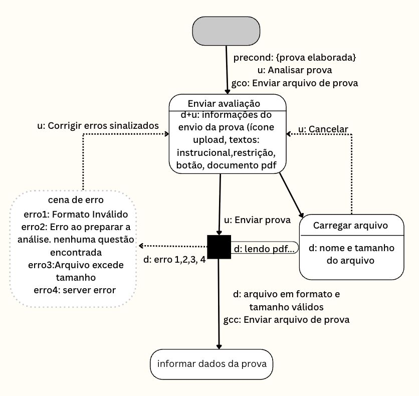

# Entrega 10 — MoLIC

**Data:** 02/11  
**Status:**  🟨 Em andamento   
**Responsabilidade:** 1 solução completa por integrante  

## Objetivo da atividade
<!-- 
Conversas alternativas em direcao ao mesmo objetivo 
Ex: goms, de acordo com regra de selecao tem maneiras diferencas, conv alternativas em direcao a um obj 

Nos signos definimos recuperacao de rupturas, dado essa modelagem do esquema conceitual de signos planejamos mecanismos p user se recuepra de problemas 

IMPORTANTE: pre cond: xxx acima do u:, condicao necessaria pra fala de transicao ocorrer, ex analisar  so é possivel se preencher campo de input obrigatorio

IMPORTANTE: NA MODELAGEM FAZEMOS CENA DETALHADA: cena composta pelo nome do topico e dialogos q ocorrem (dialog obaseado na lista de signo q compoe o dialog

PROCESSO APOS CLICAR E MANALISAR 

IMPORTANTE: TRACEJADO para upload invalodo de pdf, tempo maior q o amx inserido…(acho)

cena comecando, carregei diretro a cena inicial 

MAPEAR INICIO E FIM DA META
,saida de caixa preta eh sempre d e oq sai da cena eh usuario 

IMPORTANTE: Gco: obj quand oentra eh ver a lsita de documentos MTO IMPROTANTE TER GCO, pde taem hta, goms...

IMPORTANTE: ACABO MODELAGEM OLHAS E TD SETA TEM FALA DE TREANSICAO (u: ou d:? Toda seta tem q ter, a uncia q n tem u: ou d: é a q sai p difurcaao (-----_ pq tem depois , pode n usa --- e puxa as 2 setas da caixa  

IMPORTANTE: Se sai da cena 90% das vezes eh u: 
Se entra no processamento (entra na caixa preta é u:, ta saind oda caixa preta é d:) 

 -->
Modelar a interação como uma **conversa entre usuário e preposto do designer**, oferecendo visão global dos caminhos que permitem ao usuário atingir seus objetivos — incluindo alternativas e rupturas relevantes. MoLIC não deve ser reduzida a um fluxograma de telas.

<!--
Comeco a faze molic consumindo mapa de objetivos. 

OBJETIVOS NUM GERAL (O01: Analisar a estrturua de uma prova antes de aplicá-la, O02: Analisar avaliação após um desempenho baixo na aplicação, O03: Comparar duas versÕes de uma avaliação para identificar possíveis diferenças injustas) É SEMPRE ANALISAR PROVA ENTAO VAMOS DIVIDIR AS TAREFAS PRA CADA UM MODELAR UMA:

O04: enviar a avaliação em PDF (é uma cena, cena pode ser uma tela, ex menu de navegacao pode ser 1 cena e pop up de avisa upload invalido pode ser outra (navegacao como cena ubiqua), 

tópico (nome da cena): só pro projetista entende oq ocorre

PRIMEIRA FUNCIONALIDADE DO MOLIC: 
Falas dde transicao: mmudanca de topico em determinado omento dainteracaosao cenas, estados do sistema, mudanca de estado sao cenas 
u: fala d etransicao do usuario ( acao q user faz q motiva a ir p outra cena, estado )

D+u-> user ta entrando input mas sistema ta ajudando user,  

D+u, faco sistema que deixo user digita estado ex: nao deixa a pessoa digitar o estado, estado fornece um dropdown pra escolher 

-->

> Use a **notação MoLIC ensinada na disciplina**. Este template foca critérios de qualidade e não substitui a legenda/notação apresentada em aula.

## Atenção a TCCs sem interface original

O MoLIC não modela o algoritmo por dentro. Ele modela a **conversa de interação necessária para que uma pessoa use a contribuição**.

Exemplos de conversas:

- usuário escolhe dados/parâmetros → sistema valida → usuário inicia análise → sistema comunica processamento → usuário interpreta resultado;
- usuário consulta histórico → refina filtros → abre execução → compara com outra;
- administrador seleciona perfil → altera permissão → sistema comunica consequências → administrador confirma/cancela;
- analista recebe alerta → examina evidências → classifica ocorrência → registra decisão.

Modele também rupturas plausíveis: entrada inválida, falha de processamento, ausência de resultado, permissão insuficiente, filtro sem resultados, conflito de alteração, cancelamento ou necessidade de recuperação.

## M01 — Informar dados necessários para a análise

**Autor(a):** Luana Bortko Rodrigues RA:24.123.006-9  
**Cenário de interação de origem:** CI01  
**Objetivo(s):** O05(Informar os dados necessários para a análise 
**Tarefa(s) relacionada(s):** T01 - Analisar a prova  <!-- completei hihihi--> 
**Signos relevantes:** <!-- complete--> 

### Diagrama

**Fonte editável:** 

### Leitura do diagrama

Explique em texto o caminho principal e pelo menos os caminhos alternativos/rupturas mais importantes.

#### Caminho principal

1. {{ponto de abertura → cena...}}
2. {{...}}

#### Alternativas e rupturas

| Situação | Onde ocorre | Como o usuário percebe | Caminho de recuperação/saída |
|---|---|---|---|
| {{dado inválido}} | {{...}} | {{fala/feedback}} | {{...}} |

### Checklist específico de modelagem

- [ ] Existe **ponto de abertura** coerente com o início do objetivo.
- [ ] As **cenas de conversa** representam tópicos/assuntos, não nomes de páginas apenas.
- [ ] As transições/falas deixam claro o que o usuário ou o sistema comunica.
- [ ] Há **ponto(s) de encerramento** para objetivos concluídos/abandonados quando aplicável.
- [ ] Processamentos do sistema estão representados conforme a notação adotada em aula, sem “inventar” fala do usuário.
- [ ] Rupturas (breakdowns) relevantes têm feedback e caminho de recuperação, não becos sem saída.
- [ ] Acessos ubíquos/atalhos só aparecem quando semanticamente justificáveis.
- [ ] O diagrama cobre caminhos alternativos importantes, e não apenas o “happy path”.
- [ ] Nomes de objetivos, tópicos e signos são coerentes com a Entrega 9.
- [ ] O diagrama é legível em tamanho normal no GitHub.
- [ ] O MoLIC representa a conversa usuário–sistema, não o fluxo interno do algoritmo.
- [ ] Processamento, filtros, administração, relatórios e históricos incluem retornos/rupturas quando relevantes.

## M02 — Enviar a avaliação em PDF

**Autor(a):** Beatriz Manaia Lourenço Berto  
**Cenário de interação de origem:** CI02   
**Objetivo(s):** O01   
**Tarefa(s) relacionada(s):** T01 - Analisar a prova   
**Signos relevantes:** {{...}}<!-- complete--> 

### Diagrama

**Fonte editável:** 

### Leitura do diagrama

<!--Explique em texto o caminho principal e pelo menos os caminhos alternativos/rupturas mais importantes. -->

#### Caminho principal

Pré-condição (precond): {prova elaborada}  
Objetivo (gco): Enviar arquivo de prova    
Garantia de Sucesso (gcc): Enviar arquivo de prova  
1- (cena ubíqua)Acesso à plataforma: O docente acessa à plataforma e seleciona a opção "Analisar prova".  
2- Visualização dos requisitos: Ao acessar a cena Enviar avaliação, o sistema exibe as informações e restrições que o documento PDF precisa cumprir para a submissão. 
3- Confirmação do envio: O docente faz o upload do documento e confirma a ação ao clicar no botão "Enviar prova" (u: Enviar prova).  
4- Processamento: O sistema inicia a leitura e validação do documento (d: lendo pdf...).  
5- Validação de conformidade: O sistema confirma que o documento possui formato e tamanho válidos (d: arquivo em formato e tamanho válidos), satisfazendo a garantia de sucesso (gcc: Enviar arquivo de prova).  
6- Transição de tela: A interface avança automaticamente para a cena informar dados da prova. 

#### Caminho alternativo 1 (Cancelamento do carregamento)

Dado que a prova se encontra elaborada (precond: {prova elaborada}), o docente acessa à plataforma e seleciona a opção "Analisar prova" (cena ubíqua) com o objetivo de submeter o documento da avaliação (gco: Enviar arquivo de prova). Na cena Enviar avaliação, o sistema exibe os requisitos para o envio correto do documento PDF. Após selecionar e anexar o arquivo, o sistema avança para a cena Carregar arquivo, apresentando as informações carregadas (d: nome e tamanho do arquivo). Ao constatar que anexou o documento incorreto, o docente aciona a opção de cancelamento (u: Cancelar), interrompendo o envio e retornando à cena Enviar avaliação para nova seleção do arquivo.

#### Caminho alternativo 2 (Tratamento de Erro)

Dado que a prova se encontra elaborada (precond: {prova elaborada}), o docente acede à plataforma e seleciona a opção "Analisar prova" (cena ubíqua) com o objetivo de submeter o documento da avaliação (gco: Enviar arquivo de prova). Ao acessar a cena Enviar avaliação, o sistema exibe as informações de envio do documento PDF. O docente confirma a submissão ao clicar em "Enviar prova" (u: Enviar prova), momento em que o sistema executa o processamento do arquivo (d: lendo pdf...). Caso ocorra uma falha na validação (d: erro 1, 2, 3, 4), a interface redireciona para a cena de erro, exibindo a mensagem correspondente ao problema identificado (erro1: Formato Inválido, erro2: Erro ao preparar a análise. nenhuma questão encontrada, erro3: Arquivo excede tamanho ou erro4: server error). Para prosseguir, o docente seleciona a opção de correção (u: Corrigir erros sinalizados), retornando à cena Enviar avaliação para realizar os ajustes necessários e tentar uma nova submissão.

#### Alternativas e rupturas

| Situação | Onde ocorre | Como o usuário percebe | Caminho de recuperação/saída |
|---|---|---|---|
| Formato de arquivo inválido | na validação do documento enviado | mensagem de erro(feedback) informando que o formato do arquivo não é aceito | o docente retorna à cena de Enviar avaliação, corrige o formato e envia o arquivo novamente |
| Nenhuma questão encontrada | durante o processamento e a preparação da análise da prova, após o envio | mensagem informando que nenhuma questão foi identificada no documento(feedback) | o docente revisa o documento anexado, corrige possíveis problemas na estrutura da prova e realiza um novo envio |
| Arquivo excede o tamanho permitido | na validação do arquivo enviado | mensagem informando que ocorreu um erro interno e que não foi possível concluir o processamento(feedback)) | o docente pode tentar enviar o arquivo novamente ou sair da operação |
| Erro no servidor | durante o processamento do documento, após o envio | mensagem informando que ocorreu um erro interno e que não foi possível concluir o processamento(feedback) | o docnete pode tentar enviar o arquivo novamente ou sair da operação |
| Cancelamento do envio | Após enviar a avaliação | o docente seleciona a opção "cancelar, simbolizada pelo botão "X"na cor vermelha | o sistema interrompe a operação/remove o arquivo anexado e retorna à etapa anterior de enviar avaliação, sem prosseguri com o envio da prova |

### Checklist específico de modelagem

- [X] Existe **ponto de abertura** coerente com o início do objetivo.
- [X] As **cenas de conversa** representam tópicos/assuntos, não nomes de páginas apenas.
- [X] As transições/falas deixam claro o que o usuário ou o sistema comunica.
- [X] Há **ponto(s) de encerramento** para objetivos concluídos/abandonados quando aplicável.
- [X] Processamentos do sistema estão representados conforme a notação adotada em aula, sem “inventar” fala do usuário.
- [X] Rupturas (breakdowns) relevantes têm feedback e caminho de recuperação, não becos sem saída.
- [X] Acessos ubíquos/atalhos só aparecem quando semanticamente justificáveis.
- [X] O diagrama cobre caminhos alternativos importantes, e não apenas o “happy path”.
- [X] Nomes de objetivos, tópicos e signos são coerentes com a Entrega 9.
- [X] O diagrama é legível em tamanho normal no GitHub.
- [X] O MoLIC representa a conversa usuário–sistema, não o fluxo interno do algoritmo.
- [ ] Processamento, filtros, administração, relatórios e históricos incluem retornos/rupturas quando relevantes.

## M03 — Consultar as métricas/analise da prova

**Autor(a):** Nuno Martins Guilhermino da Silva RA: 22.126.099-5  
**Cenário de interação de origem:** CI03  
**Objetivo(s):** O03   
**Tarefa(s) relacionada(s):**  T01 - Analisar a prova  
**Signos relevantes:** {{...}}<!-- complete--> 

### Diagrama

**Fonte editável:** 

### Leitura do diagrama

Explique em texto o caminho principal e pelo menos os caminhos alternativos/rupturas mais importantes.

#### Caminho principal

1. {{ponto de abertura → cena...}}
2. {{...}}

#### Alternativas e rupturas

| Situação | Onde ocorre | Como o usuário percebe | Caminho de recuperação/saída |
|---|---|---|---|
| {{dado inválido}} | {{...}} | {{fala/feedback}} | {{...}} |

### Checklist específico de modelagem

- [ ] Existe **ponto de abertura** coerente com o início do objetivo.
- [ ] As **cenas de conversa** representam tópicos/assuntos, não nomes de páginas apenas.
- [ ] As transições/falas deixam claro o que o usuário ou o sistema comunica.
- [ ] Há **ponto(s) de encerramento** para objetivos concluídos/abandonados quando aplicável.
- [ ] Processamentos do sistema estão representados conforme a notação adotada em aula, sem “inventar” fala do usuário.
- [ ] Rupturas (breakdowns) relevantes têm feedback e caminho de recuperação, não becos sem saída.
- [ ] Acessos ubíquos/atalhos só aparecem quando semanticamente justificáveis.
- [ ] O diagrama cobre caminhos alternativos importantes, e não apenas o “happy path”.
- [ ] Nomes de objetivos, tópicos e signos são coerentes com a Entrega 9.
- [ ] O diagrama é legível em tamanho normal no GitHub.
- [ ] O MoLIC representa a conversa usuário–sistema, não o fluxo interno do algoritmo.
- [ ] Processamento, filtros, administração, relatórios e históricos incluem retornos/rupturas quando relevantes.

> Repita M02, M03... para todos os integrantes.

## Consolidação da equipe

### Cobertura dos objetivos

| Objetivo | MoLIC que cobre | Lacunas/duplicidades | Decisão |
|---|---|---|---|
| O01 | M01 | {{...}} | {{...}} |

### Preparação para o Figma

Liste os estados/telas que serão necessários **a partir das conversas modeladas**, incluindo feedback, confirmação, erro e recuperação.

## Erros frequentes a evitar

- desenhar apenas caixas com nomes de telas e setas de navegação;
- não modelar falhas, cancelamento, volta ou recuperação;
- usar rótulos genéricos (“Tela 1”, “Processo 2”) sem tópico de conversa;
- criar no Figma fluxos que não existem no MoLIC;
- diagrama sem legenda/fonte editável e com texto ilegível.
